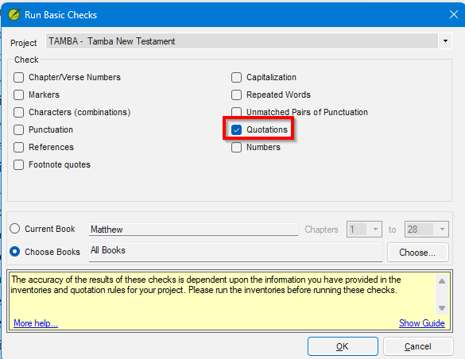

# Lesson 1 — What the Quotation Check Does

**Estimated time:** 30 minutes

**Purpose:** On a real project you will often be handed a Quotation check that is either
screaming with errors, reporting a handful of plausible-looking ones, or silent — and a
translation team asking what it means. Before you can help, you have to recognize when the
check's results can't be trusted because its settings are still Paratext's defaults rather than
the team's conventions, and be able to explain that to the team. This lesson prepares you for
that first conversation.

> This lesson uses the **Tamba New Testament** (`TAMBA`) practice project. See the
> [course README](README.md#the-practice-projects) for the Tamba quotation conventions and
> [Prerequisites](README.md#prerequisites) for setup.

**Watch the video:** _To be recorded at stage 8._

## Learning objectives

By the end of this lesson you will be able to:

- Explain why the Quotation check cannot produce trustworthy results until its settings
  describe the team's own conventions.
- Name the two inputs Paratext needs — the Quote marks tab and the Quotation types tab — before
  the check is meaningful.
- Run the check on a project still at Paratext's default settings and explain why its results
  are not yet a list of things to fix in the text.

## Connect

Think about the language project you work with — or one you have seen a colleague support.

**✏️ Reflection.** Bring to mind a time you ran an automated check (spelling, punctuation,
basic checks) and it either flooded the screen with results or returned nothing at all.

- What did you do first — start fixing the results, or step back and ask whether the check was
  even set up correctly?
- How did you decide whether the results could be trusted?
- If a translator asked you "does zero errors mean my quotation marks are perfect?", what
  would you say?

Hold those answers. This lesson is about telling the difference between a check that has
*found something wrong in the text* and a check that *is looking for the wrong things*.

## Content

*Configuring and troubleshooting a project's checks is core to the **Translation Tools**
competency — being able to "use translation tools and troubleshoot issues that arise." The
Quotation check is a good first case because its results mean little until its settings
describe the team's conventions, and recognizing that is half the skill.*

Paratext's **Quotation check** (☰ > Tools > Run basic checks... > Quotations) scans your
translation for unmatched, unopened, or incorrectly nested quotation marks. It reads two sets
of settings, both in **☰ > Project settings > Quotation Rules**:

1. **Quote marks tab** — which characters in your text are quotation marks, and at what level
   (Opening, Quote Continuer at new paragraph, Closing for each level).
2. **Quotation types tab** — for each semantic category of speech, whether marks are required,
   forbidden, or optional.

### A new project already has settings — Paratext's, not the team's

Those tabs are never empty. Every new project in Paratext 9.5 starts with these default quote
marks:

| Level | Opening | Quote Continuer at new paragraph | Closing |
| --- | --- | --- | --- |
| First level | `“` | `“` | `”` |
| Second level | `‘` | `‘` | `’` |
| Third level | `“` | `“` | `”` |

The **Continuer required at** field below the grid reads `p p/q1 b/q1`, and the Quotation types
tab is on **Use recommended settings** with its check switched off.

That is the trap. The tab *looks* configured, and the check runs and reports results. But
nobody on the translation team chose those settings. Paratext chose them. Until someone
compares every cell with the team's own conventions, the check is measuring the text against
somebody else's rules. Depending on how far the defaults are from the team's conventions, you
will see one of three things:

- **A handful of plausible results.** Close to the team's conventions, but not quite. The few
  results look like real mistakes in the text. You will see this in Exercise 1.1.
- **A flood.** Far from the conventions. The Runda project you meet in Lesson 2 reports 1110
  results at the defaults.
- **A false silence.** The project's marks aren't in the defaults at all, so the check
  recognizes no quote marks and reports "No errors found." The Menda project in the scenario
  bank does exactly this, although its text is full of dialogue.

**NOTE** "No errors found" on a project still at the defaults does *not* mean the translation
has no quotation errors. It can mean the check doesn't recognize any of the text's marks as
quote marks. The check is reporting silence, not correctness.

**Key takeaways**

- The Quotation check needs both the Quote marks tab (which characters are quote marks) and
  the Quotation types tab (when marks are expected) before it gives trustworthy results.
- A new project starts with Paratext's defaults. They look like a configuration, but they are
  not the team's conventions.
- Don't interpret results, or touch the text, until the settings match the team's conventions.
  Never add or delete marks in the text to make a default-settings result go away.

## Challenge

### Exercise 1.1 — Run the check at Paratext's defaults

**The situation.** You are supporting the **Tamba New Testament** team. The team lead has run
the Quotations check for the first time and messaged you: *"The quotation check found five
places in John 17 where we forgot to close the speech. Should we add the closing marks?"* Your
job is to see for yourself what the check reports, and then write the team lead a short,
honest explanation.

**Do it in Paratext:**

1. Open the `TAMBA` project.
2. Click **☰ > Tools > Run basic checks...**
3. In the dialog, tick **Quotations** only (leave "Quotation types" unticked — it is a
   separate check).
4. Click **Choose Books** and select all NT books available in the `TAMBA` project, then click
   **OK**. This runs the check across the whole project.

**NOTE** A yellow information bar at the bottom of the dialog reads *"The accuracy of the
results of these checks is dependent upon the information you have provided in the inventories
and quotation rules for your project."* That sentence is the point of this lesson.

5. Look at the results list.

6. Open **☰ > Project settings > Quotation Rules**, look at the **Quote marks** tab, and compare
   it with Tamba's conventions in the [README](README.md#the-practice-projects). Then click
   **Cancel**. You change nothing in this lesson.

**TIP** Each exercise in this course tells you which scope to run — the whole project with
**Choose Books**, or one book with **Current Book**. Follow it, because the results each
exercise describes are for that scope.

**✏️ Discovery prompts** (answer these before you write anything):

- Who chose the settings on the Quote marks tab? Do they match the README's table for Tamba,
  including the **Continuer required at** field?
- The results say a speech was opened and never closed. Does that tell you something is wrong
  with the text, or only that the text doesn't fit the settings the check is using?
- If the team added five closing marks to John 17, what would they be changing — the settings,
  or the Scripture text?

**What you should observe:** five results, all in John 17, each reading *"Opening quote mark
found without matching closing quote mark: “"*. They look like five speeches someone forgot to
close. They aren't. Tamba's Phase A text is correct; the course has checked it. The results
come from the settings: `TAMBA` is still at Paratext's defaults, and the defaults don't
describe how Tamba's text is laid out. In Lesson 2 you will find the exact setting responsible.

Look at the other two outcomes from the Content section. On a project like Runda, the same
defaults produce more than a thousand results; on one like Menda, none at all. Five results,
a thousand, or none: none of them can be trusted until the settings describe the team's
conventions.

Adding closing marks to John 17 would change correct Scripture to satisfy a setting nobody
chose. The fix belongs in the settings. Once they match the team's conventions, any result
that still points at the text is a question to raise with the translation team — and in this
case, there won't be any.

**✏️ Produce this (a mentor will review it).** Write the team lead a 2–3 sentence reply that
(a) answers whether they should add the closing marks, and (b) says what has to happen before
the check can be trusted. Keep it plain enough for a non-technical translator to understand.

## Change

**Self-assessment — can you explain it to a colleague?**

1. The Quotations check on a project still at Paratext's defaults returns "No errors found."
   Does this mean the translation has no quotation errors?
2. What are the two things Paratext needs before the Quotations check gives meaningful results?
3. The team lead wants to add closing marks in John 17 to clear the five results. What do you
   tell them?

*You should be able to say:* (1) No — the defaults may not include the project's quote marks at
all, so the check may not recognize any marks in the text. It is reporting silence, not
correctness. (2) The Quote marks tab (which characters are quote marks and at what level) and
the Quotation types tab (whether each category of speech requires, forbids, or optionally
allows marks), both set to match the team's conventions. (3) Don't — the results come from
Paratext's default settings, not from the team's conventions. First correct the settings and
re-run the check. If anything still points at the text after that, it goes back to the
translation team; it isn't yours to rewrite.

**✏️ Take it to your context.** Name one real project you support (or expect to). Has anyone
ever compared its Quotation Rules with the team's conventions, or is it still at Paratext's
defaults? Write down one sentence you would use to set the team's expectations before running
the check for the first time.

**Next step.** In [Lesson 2](02-setting-up-quote-marks.md) you correct the first of the two
inputs: you open the Quote marks tab, compare each default cell with Tamba's conventions, and
change the ones that differ — so the check finally looks for what the team actually writes.

---

Next: [Lesson 2 — Setting Up Quote Marks](02-setting-up-quote-marks.md)
