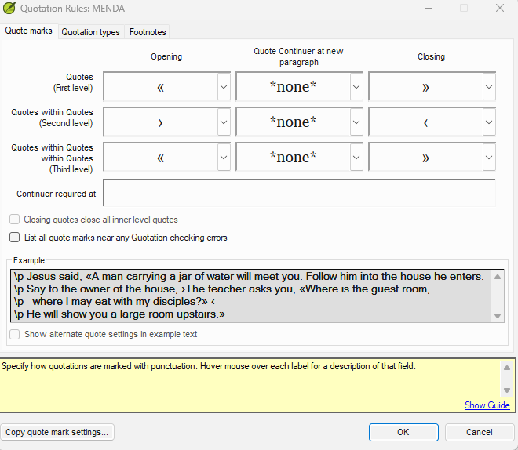

# Scenario Bank — Language Scenario Practice

**Estimated time:** 90 minutes

> Three independent scenarios, roughly 30 minutes each. Scenarios A and B are core practice;
> **Scenario C (Waku em-dash) is an optional stretch** for learners who complete A and B
> confidently. Do them in any order. Each uses its own practice project — see the
> [mentor guide](06-mentor-guide.md) for how the facilitator distributes them.

**Learning objectives:** By the end of this scenario bank you will be able to apply the complete inventory + rules + check + triage workflow independently to an unfamiliar language scenario, including edge cases not covered in Lessons 1–4.

These exercises use three new practice projects. Each has a different quotation style, and each starts where a real new project starts: with Paratext's default Quotation Rules, not the language's conventions. For each scenario follow the same four-step workflow — **inventory → rules → check → triage** — broken into eight concrete actions:

**Inventory**

1. Read the language conventions table.
2. Run the Quotations check on all books once, *before* changing anything, and note what it reports. Then answer the discovery prompts.
3. Open the Quote marks tab and compare every cell with the conventions table. It holds Paratext's defaults (`“ “ ”` at First level, `‘ ‘ ’` at Second level, `“ “ ”` at Third level, Continuer required at `p p/q1 b/q1`).
4. Correct the defaults: change every cell that differs, including continuers and unused levels that must be set to *none*, and the **Continuer required at** list.

**Rules**

5. Configure the Quotation types tab.

**Check**

6. Run the check (start with one book).

**Triage**

7. Triage the results to zero actionable errors.
8. Compare your configuration against the expected answer key.

---

## Scenario A — Guillemet (French style)

**Project:** Velna New Testament (`VELNA`)

**Velna quotation conventions:**

| Level | Opening | Unicode | Closing | Unicode |
|-------|---------|---------|---------|----------|
| First level | `«` | U+00AB | `»` | U+00BB |
| Second level | `‘` | U+2018 | `’` | U+2019 |

No Third level. First level opening mark `«` also appears at the start of continued paragraphs.

**Starting state:** Paratext's defaults. Run the Quotations check on all books before you change anything: it reports **264 results**. Most read "Second-level quote mark found without a preceding first-level quote: ‘"; there are also "Closing quote [ ’ U+2019 ] found as a word medial character" results (Matthew 1:1, for example).

**Discovery prompts:**
- Most of the 264 results say a Second level `‘` has no First level quote around it. Velna's conventions use `‘` only inside `«…»` speech. What does that tell you about whether the check can see Velna's First level marks at the defaults? Is it the text or the settings that needs attention?
- Velna uses `’` (U+2019) as both its Second level closing mark and as an apostrophe. Try adding `’` to Word-medial punctuation as Lesson 2 taught — does it actually clear the resulting check result here too?
- How would you verify that the text contains `«` (U+00AB) rather than `<<` (two less-than signs)?

**Expected configuration:**

| Level | Opening | Quote Continuer at new paragraph | Closing |
|-------|---------|----------------------------------|----------|
| First level | `«` | `«` | `»` |
| Second level | `‘` | *none* | `’` |
| Third level | *none* | *none* | *none* |

**What changes from the defaults:** all three First level cells (`“ “ ”` → `« « »`); the Second
level continuer, which must be cleared from `‘` to *none*; and all three Third level cells,
which must be cleared from `“ “ ”` to *none*, because Velna has no Third level. The Second level
Opening `‘` and Closing `’` already match.

Continuation: `«` at First level only. The verified configuration also replaces the default
**Continuer required at** list (`p p/q1 b/q1`) with `p b/q1 pi pi/pi` — the paragraph-marker
contexts where the check must insist on the continuer. Copy it exactly; without the right list
the check reads continuers `«` as new opening marks that are never closed, and a long speech
floods with unclosed-quote results.

Word-medial punctuation: add `’` (U+2019) in ☰ > Project settings > Language Settings > Other Characters tab > Word-medial punctuation — do this anyway, since it's the correct habit to build, but confirmed on a real Paratext 9.5 build, it will **not** stop the check from flagging Velna's word-medial apostrophes. That's expected: once `’` is already a configured quote mark, this setting has no effect on it. Treat any remaining apostrophe results as verified false positives, not something left to configure away. This is also the moment to remember the real fix: on a live translation team's project, you would raise with the team adopting a different, unique apostrophe character — Lesson 2 names `ʼ` (U+02BC MODIFIER LETTER APOSTROPHE) as a concrete option — rather than living with the collision indefinitely. Choosing it is an orthography decision for the translation team and the language community, not for you, and it can come up late, even close to typesetting. Velna itself keeps `’` for its apostrophes so the scenario still demonstrates the unresolvable case firsthand; the `ʼ` alternative is illustrated in Lesson 2's text, not built into this project.

**Quotation types tab:** confirmed on a real Paratext 9.5 build: Velna needs exactly **one**
change from recommended defaults — **Continued quotation = Use quote marks** (the First level
continuer means a mark is expected at every continued paragraph, same reasoning as Tamba in
Lesson 3). Unlike Tamba, Velna has no narrator-citation, self-quote, or indirect-speech
exceptions, so every other type — Normal, Quotation from another source, Self quote, Potential,
Indirect, Hypothetical — stays at its recommended default.

**Check your work:**
- After configuration, run the check on all books again and compare with the 264 you started from. Read the messages, not just the count: which kinds of result has your configuration cleared, and which are left?
- Run the check on Luke. Verify that `«...»` speech boundaries are recognized correctly and narrative passages generate no results.
- Confirm that apostrophes inside words (contractions, possessives) are still flagged even after configuring Word-medial punctuation — that's the expected, confirmed outcome for this collision, not a sign of a missing setting. Verify each is a genuine apostrophe and move on.
- Confirm the First level Quote Continuer (`«`) at the start of continued paragraphs is not flagged as an unexpected mark.
- Enable the Quotation types check and run it on Matthew, Luke, and John. It should return clean once Continued quotation is set to Use quote marks — this check is separate from the apostrophe results above, which live in the Quotations check and remain regardless.

---

## Scenario B — Angle-bracket guillemets (French/German style with nesting reversal)

**Project:** Menda New Testament (`MENDA`)

**Menda quotation conventions:**

| Level | Opening | Unicode | Closing | Unicode |
|-------|---------|---------|---------|---------|
| First level | `«` | U+00AB | `»` | U+00BB |
| Second level | `›` | U+203A | `‹` | U+2039 |
| Third level | `«` | U+00AB | `»` | U+00BB |

Note: At Second level Menda uses **single guillemets in reversed order** — the `›` (U+203A, right-pointing) opens the embedded speech and `‹` (U+2039, left-pointing) closes it. This is unusual and easy to get wrong.

At Third level Menda returns to **double guillemets** — `«` opens and `»` closes, the same characters as First level. Third level is rare; John 19:21 is the key example.

**Starting state:** Paratext's defaults. Run the Quotations check on all books before you change anything: it reports **"No errors found."**

**Discovery prompts:**
- Menda's text is full of dialogue, and the check at the defaults says "No errors found." Why isn't that good news? Which of Menda's quote marks appear anywhere in Paratext's default grid?
- Why might it be confusing that the opening mark for Second level is the right-pointing single guillemet? What would happen if you entered it in the Closing field by mistake?
- How would you verify which direction the single guillemet in the text actually points? (Hint: open the **Punctuation inventory** or the **Characters inventory**. Select a single guillemet in the upper pane to see its Unicode value, 203A or 2039. The lower pane lists the verses where it occurs, and in short verses you can see both marks of the pair. Or place the cursor just after the character and press **Alt+X** (Edit > Show/hide Unicode) to show its code, then press **Alt+X** again to switch it back.)
- If a verse shows `«Il a dit ‹oui›»` and the check flags Second level as having incorrect marks, what is the most likely cause?
- John 19:21 nests speech three levels deep. What characters does Menda use at the Third level, and what might the check report at 19:21 if the Third level cells are left at the defaults?

**Expected configuration:**

| Level | Opening | Quote Continuer at new paragraph | Closing |
|-------|---------|----------------------------------|--------|
| First level | `«` | *none* | `»` |
| Second level | `›` | *none* | `‹` |
| Third level | `«` | *none* | `»` |

**What changes from the defaults:** every cell. The six Opening and Closing cells change from
the default curly quotes to guillemets, and all three continuer cells, which default to `“`,
`‘` and `“`, must be cleared to *none*. The **Continuer required at** list changes too: clear it
from `p p/q1 b/q1` to empty. None of Menda's marks are in the defaults, which is why
the check at the defaults recognized no quote marks at all and reported "No errors found."

Continuer required at: empty. Menda has no continuer at any level, so the list has nothing to
require; set it to what the conventions say. Do it in this order: set all three continuers to
*none* first, then clear the list. Paratext won't accept an empty list while any continuer is
still set: a red **!** appears beside the field, its tooltip reads "Cannot be blank if any Quote
Continuer is specified.", and **OK** is disabled.

Continuation: none. Apostrophe handling: not needed — Menda's Quote marks tab does not use U+2019, so no Word-medial punctuation setting is required.

**Quotation types tab:** unlike Tamba (Lesson 3), Menda needs **no customization at all** — leave
it on **Use recommended settings**. Confirmed on a real Paratext 9.5 build: with the Quotation
types check enabled, Menda's text passes clean at the recommended defaults (Normal/Quotation
from another source/Self quote = Use quote marks; Continued quotation = Never use quote marks;
Potential/Indirect = Quote marks are optional; Hypothetical = Never use quote marks). Step 5 of
the scenario workflow still applies — open the tab, tick the enable checkbox, and verify with
a check run — but for Menda that verification is the whole task; there
is nothing to change.

**Check your work:**
- Run the check on John (contains clear nested dialogue). Verify that `«...›...‹...»` structures pass without errors.
- If the check fires on every Second level opening mark, the Opening and Closing fields for Second level are likely reversed. Confirm which character is right-pointing (`›`) and which is left-pointing (`‹`).
- After entering Second level, check the Example section at the bottom. If › opens and ‹ closes in the example, you have the correct order. The visual difference between `›` and `‹` is easy to miss — use the Example to confirm before clicking OK.
- John 19:21 contains Menda's rare Third level quotation. Verify it passes once Third level is configured — if 19:21 is flagged, check that the Third level cells really hold `«` and `»`, not the default `“` and `”`.
- Enable the Quotation types check and run it on John. It should return clean at recommended settings with no customization — if it doesn't, re-check your Quote marks tab entries first, since a character-level mistake there is more likely than a genuine need to customize types.

---

## Scenario C — Non-standard marks with continuation

**Project:** Waku New Testament (`Waku`)

**Waku quotation conventions:**

| Level | Opening | Unicode | Closing | Unicode |
|-------|---------|---------|---------|---------|
| First level | `—` | U+2014 | `—` | U+2014 |
| Second level | `“` | U+201C | `”` | U+201D |
| Third level | `‘` | U+2018 | `’` | U+2019 |

Waku uses an **em dash** (U+2014) for both the opening and closing mark at First level. Multi-paragraph speech does *not* restart the em dash — it uses a **continuation mark** of `—` (another em dash) at the start of each continued paragraph. Waku's word-medial apostrophe is `ʼ` (U+02BC MODIFIER LETTER APOSTROPHE), so the Third level closer `’` (U+2019) creates no apostrophe collision.

**Starting state:** Paratext's defaults. Run the Quotations check on all books before you change anything: like Menda, it reports **"No errors found."**

**Discovery prompts:**
- Waku's Second and Third level marks are the same curly quotes that appear in Paratext's defaults, and the check at the defaults reports "No errors found." Does that mean the defaults are close enough? What does the default grid say about Waku's First level em dash?
- When the same character is used for both opening and closing, how does Paratext know which is which? What rule does it rely on?
- Waku uses the em dash as a continuation mark. Should the continuation mark be a different character from the opening mark, or can it be the same character? What happens if they are the same?
- In a language where em dash is also used for parenthetical remarks (not speech), how would you expect the check to behave? Is there a way to address this?

**Expected configuration:**

| Level | Opening | Quote Continuer at new paragraph | Closing |
|-------|---------|----------------------------------|--------|
| First level | `—` | `—` | `—` |
| Second level | `“` | *none* | `”` |
| Third level | `‘` | *none* | `’` |

**What changes from the defaults:** all three First level cells (`“ “ ”` → `— — —`); the Second
level Opening and Closing (`‘ ’` → `“ ”`) and its continuer, which must be cleared from `‘` to
*none*; and the Third level Opening and Closing (`“ ”` → `‘ ’`) and its continuer, which must be
cleared from `“` to *none*.

Continuation: `—` (em dash, same character) at First level only. The verified configuration
also replaces the default **Continuer required at** list (`p p/q1 b/q1`) with
`p p/q1 b/q1 m/q1` — the paragraph-marker contexts where the check must insist on the
continuer. Copy it exactly; without it the check does not enforce the continuer at those
paragraph breaks.

**Don't stop at the marks.** If you change only the Opening and Closing marks and leave the
Second and Third level continuers filled in (as the defaults have them) and the default list in place, the check gives an
**eighth** result on top of the seven described below: Matthew 13:14, "Second-level quote mark
found without a preceding first-level quote: “". With the full configuration above, that result
goes and seven remain.

**Note on same-character open/close:** When the same character serves as both opener and closer, Paratext relies on structural context (paragraph markers, verse boundaries, and surrounding text flow) to determine which role the em dash plays. Because this context-based interpretation may not resolve every case unambiguously, human review of flagged em-dash results is always required for Waku.

**Check your work:**
- Run the check on Acts (extended speeches, heavy use of em-dash dialogue). Verify that multi-paragraph speeches with continuation marks do not generate "unclosed quote" errors.
- Check a verse where em dash is used for a parenthetical aside (not speech). Does the check flag it? What is the correct response — reconfigure if possible, or document it in a Project Note and raise the punctuation question with the translation team? (Changing the text is not your call; see below.)
- This scenario leaves results that cannot be eliminated by configuration alone — because Paratext cannot distinguish an em dash used as speech from one used as a parenthetical dash. Confirmed on a real Paratext 9.5 build, a correct configuration run against all books ends at **seven results**: six "found as a word medial character" results on genuine parenthetical em dashes (Mark 13:14 twice, 13:19, 13:22; Luke 9:3; Acts 3:1), plus one "Closing quote mark is possibly missing before verse 18.1: —" at John 17:26.
- The John 17:26 result is a different residual class from the parentheticals: the text there is *correct* — Jesus's prayer (17:1–26) opens with `—`, carries the `—` continuer at every paragraph, and closes with `—` at the end of verse 26 — but with the same character serving as opener, closer, and continuer across a long multi-paragraph speech, Paratext's context-based tracking loses the open/close state and reports the speech as possibly unclosed. No text change fixes it without breaking Waku's convention. Verify the marks are all present, then document.
- For all seven: add a Project Note (☰ > Insert > Project note...) explaining the result, so the consultant can verify it during review. Attach each note to the verse the result is reported at: Mark 13:14, 13:19, 13:22, Luke 9:3, Acts 3:1 and John 17:26. For the six parentheticals, also raise the punctuation question with the translation team: the same em dash marks both speech and parenthetical remarks, so the check can't tell them apart. Whether to change the text, for example by using different punctuation for parentheticals, is the team's decision, not yours. John 17:26 needs no question for the team: its marks are already correct.

## Scenario bank summary
- The same four-step workflow (inventory → rules → check → triage) applies to every language, however unusual its quotation conventions.
- Every project starts from Paratext's defaults, and the defaults can mislead in either direction: 264 results for Velna, "No errors found" for Menda and Waku. Correct every cell to the conventions, including the ones that must become *none*, before you trust any result.
- Always verify entered characters using the Example section at the bottom of the Quote marks tab — on unfamiliar languages it is easy to confuse visually similar characters.
- Some languages (like Waku) will always require human review of residual results; zero configuration errors does not always mean zero results.

## Scenario check-your-understanding

1. You enter Second level Opening as `‹` and Second level Closing as `›` for the Menda project, then run the check and find that every Second level opening mark generates a result. The Example section in the Quote marks tab shows the marks in reversed order from what you expect. What went wrong, and what is the fix?
2. In Scenario B you enter Second level as Opening: U+2039, Closing: U+203A (reversed from the correct order). What will the check report?
3. After completing Scenario C (Waku), 7 results remain in the Basic Checks panel — six em dashes used as parenthetical remarks (not speech), plus one "possibly missing" result on a multi-paragraph speech whose marks are all correctly in place. Configuration cannot eliminate them. What are your options?

**Answers**

1. The characters were entered in the wrong fields — the left-pointing guillemet (`‹`, U+2039) is in the Opening field when it should be in the Closing field, and vice versa. Swap them: Opening should be `›` (right-pointing, U+203A), Closing should be `‹` (left-pointing, U+2039). Confirm by checking the Example section — the correct order shows `›` as the inner opening and `‹` as the inner closing.
2. The check will fire on every Second level opening mark (treating the right-pointing guillemet as an unexpected closing mark) and on every Second level closing mark (treating the left-pointing guillemet as an unexpected opening mark). The entire Second level configuration will appear as errors.
3. Document all seven with a Project Note (☰ > Insert > Project note...) explaining the result, attached to the verse it is reported at (Mark 13:14, 13:19, 13:22, Luke 9:3, Acts 3:1, John 17:26), so the consultant can verify it during review. The Basic Checks panel results will remain; documenting them prevents them from being mistaken for unreviewed errors. For the six parentheticals, also raise the punctuation question with the translation team: their em dash marks both speech and parenthetical remarks, and the check can't tell the two apart. Whether to change the text, for example by using different punctuation for parentheticals, is the team's decision; you don't rewrite the verses. The John 17:26 result needs only the note, since its marks are already correct.

---

## Where to Go from Here

### How the Quotation check fits in the Paratext checking workflow

The Quotation check is one of the **Basic Checks** in Paratext 9.5 (run via **☰ > Tools > Run basic checks...**). Basic Checks are typically run and cleared before a book moves to Consultant Check (CC). A consultant reviewer will re-run the checks during review, so the goal is a configuration that genuinely models the language — not a result list emptied by erasing correct text.

The recommended sequence for a book heading toward CC:

1. Run all Basic Checks (Quotations, Characters, Markers, Footnotes, and others).
2. Clear each check to zero results by fixing text errors and refining the configuration.
3. Where a residual result cannot be cleared by configuration (see Scenario C), document it with a Project Note so the consultant can verify it quickly.

The Quotation check does not need to be perfect before work continues, but it must be clean before CC begins.

### Maintaining the configuration over time

Quotation Rules are set once per project and persist across sessions, but they need attention when:

- **New text is added.** Re-run the check after each significant drafting session; new text may introduce new errors.
- **A new translator joins.** Check whether they are typing the same quote-mark characters as the rest of the team. Open the **Punctuation inventory**, select a quote mark in the upper pane to see its Unicode value, and look in the lower pane for the verses where it occurs; a look-alike, such as a straight `"` (U+0022) where the conventions use `“` (U+201C), shows up as a separate entry. If you find one, raise it with the team; a find-and-replace on the new chapters may be what they decide to do.
- **A new book is started.** Some books (like Psalms, Proverbs, or Revelation) have different poetry/prose ratios. Re-run the check after completing the first draft to confirm that poetry lines (`\q`, `\q2`) are not generating false quotation results.

### Copying Quotation Rules to another project

If your language has more than one translation project (for example, a study Bible alongside the main translation), you do not need to reconfigure the Quote marks tab from scratch. Paratext 9.5 can copy settings from a base project:

Open **☰ > Project settings > Quotation Rules** on the destination project. At the bottom of the dialog, click **Copy quote mark settings...** and select the already-configured project as the source. It copies the quote marks but **not** the **Continuer required at** list, so type that by hand; otherwise the destination keeps the list it already had (on a new project, the default `p p/q1 b/q1`). Review every field after copying — differences in verse structure or text conventions between the two projects may require adjustments.

### What a well-configured project looks like

A project with correctly configured Quotation Rules will:

- Return zero results in purely narrative passages with no speech.
- Return zero results on apostrophes and possessives.
- Flag only genuine mismatches — missing marks, extra marks, wrong-level marks — in speech sections.
- Have any residual results (where the same character serves two linguistic purposes and configuration cannot distinguish them) documented in Project Notes (☰ > Insert > Project note...) so a consultant reviewer can verify them without asking for clarification.

Reaching that state is what this course has prepared you to do.

---

Previous: [Lesson 4 — Interpreting and Clearing the Check](04-interpreting-and-clearing-the-check.md) · Assessment: [Quiz](07-quiz.md)
