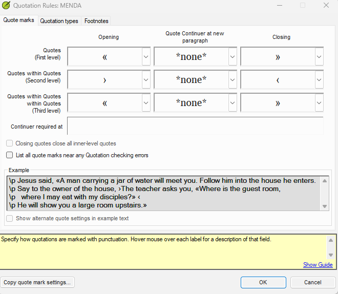
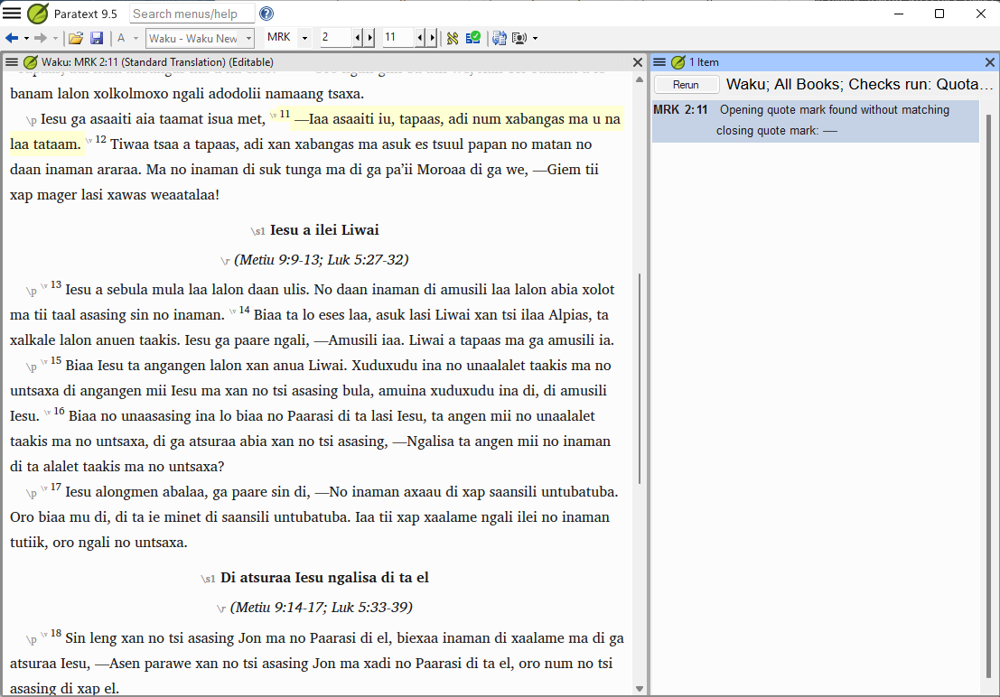
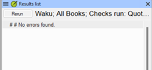

# Scenario Bank — Language Scenario Practice

**Estimated time:** 90 minutes

> Three independent scenarios, roughly 30 minutes each. Scenarios A and B are core practice;
> **Scenario C (Waku) is an optional stretch** for learners who complete A and B
> confidently. Do them in any order. Each uses its own practice project — see the
> [mentor guide](06-mentor-guide.md) for how the facilitator distributes them.

**Learning objectives:** By the end of this scenario bank you will be able to apply the complete inventory + rules + check + triage workflow independently to an unfamiliar language scenario, including edge cases not covered in Lessons 1–4.

These exercises use three new practice projects. Each has a different quotation style, and each starts where a real new project starts: with Paratext's default Quotation Rules, not the language's conventions. For each scenario follow the same four-step workflow — **inventory → rules → check → triage** — broken into eight concrete actions:

**Inventory**

1. Read the language conventions table.
2. Run the Quotations check on all books once, *before* changing anything, and note what it reports. Then answer the discovery prompts.
3. Open the Quote marks tab and compare every cell with the conventions table. It holds Paratext's defaults (`“ “ ”` at First level, `‘ ‘ ’` at Second level, `“ “ ”` at Third level, Continuer required at `p p/q1 b/q1`).
4. Correct the defaults: change every cell that differs, including continuers and unused levels that must be set to *none*, and the **Continuer required at** list.

**Rules**

5. Configure the Quotation types tab.

**Check**

6. Run the check (start with one book).

**Triage**

7. Triage the results to zero actionable errors.
8. Compare your configuration against the expected answer key.

---

## Scenario A — Guillemet (French style)

**Project:** Velna New Testament (`VELNA`)

**Velna quotation conventions:**

| Level | Opening | Unicode | Closing | Unicode |
|-------|---------|---------|---------|----------|
| First level | `«` | U+00AB | `»` | U+00BB |
| Second level | `‘` | U+2018 | `’` | U+2019 |

No Third level. First level opening mark `«` also appears at the start of continued paragraphs.

**Starting state:** Paratext's defaults. Run the Quotations check on all books before you change anything: it reports **264 results**. Most read "Second-level quote mark found without a preceding first-level quote: ‘"; there are also "Closing quote [ ’ U+2019 ] found as a word medial character" results (Matthew 1:1, for example).

**Discovery prompts:**
- Most of the 264 results say a Second level `‘` has no First level quote around it. Velna's conventions use `‘` only inside `«…»` speech. What does that tell you about whether the check can see Velna's First level marks at the defaults? Is it the text or the settings that needs attention?
- Velna uses `’` (U+2019) as both its Second level closing mark and as an apostrophe. Try adding `’` to Word-medial punctuation as Lesson 2 taught — does it actually clear the resulting check result here too?
- How would you verify that the text contains `«` (U+00AB) rather than `<<` (two less-than signs)?

**Expected configuration:**

| Level | Opening | Quote Continuer at new paragraph | Closing |
|-------|---------|----------------------------------|----------|
| First level | `«` | `«` | `»` |
| Second level | `‘` | *none* | `’` |
| Third level | *none* | *none* | *none* |

**What changes from the defaults:** all three First level cells (`“ “ ”` → `« « »`); the Second
level continuer, which must be cleared from `‘` to *none*; and all three Third level cells,
which must be cleared from `“ “ ”` to *none*, because Velna has no Third level. The Second level
Opening `‘` and Closing `’` already match.

Continuation: `«` at First level only. The verified configuration also replaces the default
**Continuer required at** list (`p p/q1 b/q1`) with `p b/q1 pi` — the paragraph-marker
contexts where the check must insist on the continuer. Copy it exactly; without the right list
the check reads continuers `«` as new opening marks that are never closed, and a long speech
floods with unclosed-quote results.

Word-medial punctuation: add `’` (U+2019) in ☰ > Project settings > Language Settings > Other Characters tab > Word-medial punctuation — do this anyway, since it's the correct habit to build, but confirmed on a real Paratext 9.5 build, it will **not** stop the check from flagging Velna's word-medial apostrophes. That's expected: once `’` is already a configured quote mark, this setting has no effect on it. You will also see the same yellow warning triangle (⚠) Lesson 2 Exercise 2.3 showed you, in both dialogs: at the end of the Word-medial punctuation field and in the Second level Closing cell on the Quote marks tab, each with the hover message described there. That is expected too; click **OK** anyway. Treat any remaining apostrophe results as verified false positives, not something left to configure away. This is also the moment to remember the real fix: on a live translation team's project, you would raise with the team adopting a different, unique apostrophe character — Lesson 2 names `ʼ` (U+02BC MODIFIER LETTER APOSTROPHE) as a concrete option — rather than living with the collision indefinitely. Choosing it is an orthography decision for the translation team and the language community, not for you, and it can come up late, even close to typesetting. Velna itself keeps `’` for its apostrophes so the scenario still demonstrates the unresolvable case firsthand; the `ʼ` alternative is illustrated in Lesson 2's text, not built into this project.

**Quotation types tab:** confirmed on a real Paratext 9.5 build: Velna needs exactly **one**
change from recommended defaults — **Continued quotation = Use quote marks** (the First level
continuer means a mark is expected at every continued paragraph, same reasoning as Tamba in
Lesson 3). Unlike Tamba, Velna has no narrator-citation, self-quote, or indirect-speech
exceptions, so every other type — Normal, Quotation from another source, Self quote, Potential,
Indirect, Hypothetical — stays at its recommended default.

**Check your work:**
- After configuration, run the check on all books again and compare with the 264 you started from. Read the messages, not just the count: which kinds of result has your configuration cleared, and which are left?
- Run the check on Luke. Verify that `«...»` speech boundaries are recognized correctly. Don't expect narrative passages to be free of results: Velna's text uses `’` for more than its Second level closing mark. It is also a glottal stop (at Matthew 1:1, Luke 1:1 and John 1:1, for example, though not at Mark 1:1) and appears in contractions (Matthew 1:6 and 1:20, for example), in narrative as well as in speech.
- Confirm that the `’` used as a glottal stop or in a contraction is still flagged even after configuring Word-medial punctuation — that's the expected, confirmed outcome for this collision, not a sign of a missing setting. Verify each is a genuine apostrophe and move on.
- Confirm the First level Quote Continuer (`«`) at the start of continued paragraphs is not flagged as an unexpected mark.
- Enable the Quotation types check and run it on Matthew, Luke, and John. It should return clean once Continued quotation is set to Use quote marks — this check is separate from the apostrophe results above, which live in the Quotations check and remain regardless.

---

## Scenario B — Angle-bracket guillemets (French/German style with nesting reversal)

**Project:** Menda New Testament (`MENDA`)

**Menda quotation conventions:**

| Level | Opening | Unicode | Closing | Unicode |
|-------|---------|---------|---------|---------|
| First level | `«` | U+00AB | `»` | U+00BB |
| Second level | `›` | U+203A | `‹` | U+2039 |
| Third level | `«` | U+00AB | `»` | U+00BB |

Note: At Second level Menda uses **single guillemets in reversed order** — the `›` (U+203A, right-pointing) opens the embedded speech and `‹` (U+2039, left-pointing) closes it. This is unusual and easy to get wrong.

At Third level Menda returns to **double guillemets** — `«` opens and `»` closes, the same characters as First level. Third level is rare; John 19:21 is the key example.

**Starting state:** Paratext's defaults. Run the Quotations check on all books before you change anything: it reports **"No errors found."**

**Discovery prompts:**
- Menda's text is full of dialogue, and the check at the defaults says "No errors found." Why isn't that good news? Which of Menda's quote marks appear anywhere in Paratext's default grid?
- Why might it be confusing that the opening mark for Second level is the right-pointing single guillemet? What would happen if you entered it in the Closing field by mistake?
- How would you verify which direction the single guillemet in the text actually points? (Hint: open the **Punctuation inventory** or the **Characters inventory**. The upper pane always shows each character's Unicode value in its own column, so you can read 203A or 2039 there without selecting anything. Select a single guillemet and the lower pane lists the verses where it occurs, and in short verses you can see both marks of the pair. Or place the cursor just after the character and press **Alt+X** (Edit > Show/hide Unicode) to show its code, then press **Alt+X** again to switch it back.)
- If a verse shows `«Il a dit ‹oui›»` and the check flags Second level as having incorrect marks, what is the most likely cause?
- John 19:21 nests speech three levels deep. What characters does Menda use at the Third level, and what might the check report at 19:21 if the Third level cells are left at the defaults?

**Expected configuration:**

| Level | Opening | Quote Continuer at new paragraph | Closing |
|-------|---------|----------------------------------|--------|
| First level | `«` | *none* | `»` |
| Second level | `›` | *none* | `‹` |
| Third level | `«` | *none* | `»` |

**What changes from the defaults:** every cell. The six Opening and Closing cells change from
the default curly quotes to guillemets, and all three continuer cells, which default to `“`,
`‘` and `“`, must be cleared to *none*. The **Continuer required at** list changes too: clear it
from `p p/q1 b/q1` to empty. None of Menda's marks are in the defaults, which is why
the check at the defaults recognized no quote marks at all and reported "No errors found."

Continuer required at: empty. Menda has no continuer at any level, so the list has nothing to
require; set it to what the conventions say. Do it in this order: set all three continuers to
*none* first, then clear the list. Paratext won't accept an empty list while any continuer is
still set: a red **!** appears beside the field, its tooltip reads "Cannot be blank if any Quote
Continuer is specified.", and **OK** is disabled.

Continuation: none. Apostrophe handling: not needed — Menda's Quote marks tab does not use U+2019, so no Word-medial punctuation setting is required.

**Quotation types tab:** unlike Tamba (Lesson 3), Menda needs **no customization at all** — leave
it on **Use recommended settings**. Confirmed on a real Paratext 9.5 build: with the Quotation
types check enabled, Menda's text passes clean at the recommended defaults (Normal/Quotation
from another source/Self quote = Use quote marks; Continued quotation = Never use quote marks;
Potential/Indirect = Quote marks are optional; Hypothetical = Never use quote marks). Step 5 of
the scenario workflow still applies — open the tab, tick the enable checkbox, and verify with
a check run — but for Menda that verification is the whole task; there
is nothing to change.

**Check your work:**
- Run the check on John (contains clear nested dialogue). Verify that `«...›...‹...»` structures pass without errors.
- If the check fires on every Second level opening mark, the Opening and Closing fields for Second level are likely reversed. Confirm which character is right-pointing (`›`) and which is left-pointing (`‹`).
- After entering Second level, check the Example section at the bottom. If › opens and ‹ closes in the example, you have the correct order. The visual difference between `›` and `‹` is easy to miss — use the Example to confirm the order, and press **Alt+X** in each cell to confirm the character (203A in Opening, 2039 in Closing; press **Alt+X** again to switch it back) before clicking OK.
- John 19:21 contains Menda's rare Third level quotation. Verify it passes once Third level is configured — if 19:21 is flagged, check that the Third level cells really hold `«` and `»`, not the default `“` and `”`.
- Enable the Quotation types check and run it on John. It should return clean at recommended settings with no customization — if it doesn't, re-check your Quote marks tab entries first, since a character-level mistake there is more likely than a genuine need to customize types.

---

## Scenario C — Two opening marks at First level (stretch)

**Project:** Waku New Testament (`Waku`)

> **NOTE:** Scenario C is a stretch exercise. Attempt it once Scenarios A and B feel
> comfortable.

**Waku quotation conventions:**

| Level | Opening | Unicode | Closing | Unicode |
|-------|---------|---------|---------|---------|
| First level | `“`, or alternatively `—` | U+201C, alternate U+2014 | `”` (an em-dash quote may have none) | U+201D |
| Second level | `“` | U+201C | `”` | U+201D |
| Third level | `‘` | U+2018 | `’` | U+2019 |

Waku's First level has **two opening marks**: the curly `“` (U+201C) and, as an alternate, the
**em dash** `—` (U+2014). A quote opened with `“` is closed by `”` (U+201D). A quote opened with
`—` may also be closed by `”`, or it may have no closing mark at all: the quote then ends at the
end of the paragraph. Waku uses **no quote continuers** at
any level: a new paragraph inside a speech does not start with a quote mark. Waku's word-medial
apostrophe is `ʼ` (U+02BC MODIFIER LETTER APOSTROPHE), so the Third level closer `’` (U+2019)
creates no apostrophe collision.

**Starting state:** Paratext's defaults. Run the Quotations check on all books before you change anything: like Menda, it reports **"No errors found."**

**Discovery prompts:**
- Waku's text is full of dialogue, its curly quotes look like the ones in Paratext's defaults, and the check at the defaults reports "No errors found." Does that mean the defaults are close enough? Compare the default grid with Waku's conventions level by level. Which level's marks match, which are swapped, and where in the default grid is the em dash?
- Waku's First level has two opening marks. The Quote marks tab has one Opening cell per level. How does that one cell hold both?
- Waku has no continuers at any level. What does that mean for the three continuer cells and for the **Continuer required at** list? Remember from Scenario B the order Paratext makes you do it in.
- When the configured check reports a single result in one verse, which is more likely: a real error or a configuration problem? (Lesson 4, Exercise 4.1, step 6.)
- You can't read Waku. If a result points at an em dash, what can you check for yourself, and what do you take to the translation team?

**Expected configuration:**

| Level | Opening | Quote Continuer at new paragraph | Closing |
|-------|---------|----------------------------------|--------|
| First level | `“` (U+201C), with `—` (U+2014) as an alternate opening mark | *none* | `”` (U+201D) |
| Second level | `“` (U+201C) | *none* | `”` (U+201D) |
| Third level | `‘` (U+2018) | *none* | `’` (U+2019) |

On the Quote marks tab, the First level Opening cell shows both marks as `“|—`: the main mark
first, then the alternate.

To enter both marks in the First level Opening cell:

1. Choose `“` from the cell's drop-down list.
2. Type a vertical line `|` straight after it.
3. Type `2014`, then press **Alt+X** to turn it into the em dash `—`.

The vertical line separates the main mark from the alternate.

**What changes from the defaults:** almost every cell. At First level, the Opening keeps `“` but
gains `—` as an alternate (`“` → `“|—`), the continuer is cleared from `“` to *none*, and the
Closing `”` already matches. At Second level, the Opening and Closing change from `‘ ’` to `“ ”`
and the continuer is cleared from `‘` to *none*. At Third level, the Opening and Closing change
from `“ ”` to `‘ ’` and the continuer is cleared from `“` to *none*. The defaults put Waku's
Second and Third level marks the wrong way round and don't contain the em dash at all.

Continuer required at: empty. As with Menda, Waku has no continuer at any level, so the list
has nothing to require. Do it in the same order: set all three continuers to *none* first, then
clear the list. Paratext won't accept an empty list while any continuer is still set.

**Check your work:**
- Before you run anything, press **Alt+X** in each cell you changed to confirm the character (press **Alt+X** again to switch it back). In the First level Opening cell, confirm that both marks are there: `“` (201C) and `—` (2014). An en dash `–` (U+2013) or a hyphen looks very like an em dash.
- Run the Quotations check on all books. Confirmed on a real Paratext 9.5 build, the expected configuration gives exactly **one result**: `MRK 2:11`, "Opening quote mark found without matching closing quote mark: —". If you see more than that, compare your Quote marks tab with the expected configuration before you go any further.

- Classify the result. It is a **real error** in the text, and the error is in the
  paragraphing, not in the marks. An em-dash quote with no closing mark is normal in Waku,
  because it ends at the end of its paragraph. The speech at 2:11 has no closing mark, and before
  its paragraph ends, verse 12 has a second em dash that opens another speech. So the first
  speech is still open when the second one starts. A paragraph break is missing between them.
  Both em dashes are correct and stay.
- Don't change the configuration to make the result go away, and don't delete either em dash.
  Removing `—` from the First level Opening cell would clear the result, and so would deleting
  the dash. Both are wrong: `—` is a genuine Waku opening mark, and the dash belongs in the text.
- Ask the translation team. You can't tell where a paragraph starts in a language you don't
  read, so ask them whether a new paragraph starts between the two speeches, and where. In this
  practice project, the team's answer is that a new paragraph starts at the sentence in verse 12
  that leads into the second em dash.
- Insert a `\p` paragraph marker at that point in verse 12.

> **[AUTHOR: confirm the steps to insert a \p paragraph break mid-verse in Paratext 9.5]**

- Close the results panel and run the check again from **☰ > Tools > Run basic checks...**. Don't click **Rerun** on the open panel, because it doesn't pick up your text change. The check on all books now reports **"No errors found."**

- Compare this "No errors found." with the one you got at the defaults. The words are the same. The difference is that the configured check proved it can see Waku's marks, because it found the missing paragraph break at Mark 2:11. The check at the defaults missed that same problem and still said "No errors found."

## Scenario bank summary
- The same four-step workflow (inventory → rules → check → triage) applies to every language, however unusual its quotation conventions.
- Every project starts from Paratext's defaults, and the defaults can mislead in either direction: 264 results for Velna, "No errors found" for Menda and Waku. Correct every cell to the conventions, including the ones that must become *none*, before you trust any result.
- Always verify entered characters with **Alt+X** in each cell (then **Alt+X** again to switch it back) — on unfamiliar languages it is easy to confuse visually similar characters, and neither the cell nor the Example section at the bottom of the Quote marks tab can tell them apart, because both show only shapes. Use the Example section to check that the marks sit together in the right order.
- A level can have more than one opening mark: Waku's First level opens with `“` or, as an alternate, `—`, and its Opening cell shows `“|—`.
- Once the configuration is right, read what is left. Some results survive a correct configuration, like Velna's apostrophes, and you verify and document them. Others are real errors in the text, like the missing paragraph break at Waku's Mark 2:11. The translation team decides where the paragraph starts, and you insert the `\p` there. Only after that does "No errors found." mean the text is clean.

## Scenario check-your-understanding

1. You enter Second level Opening as `‹` and Second level Closing as `›` for the Menda project, then run the check and find that every Second level opening mark generates a result. The Example section in the Quote marks tab shows the marks in reversed order from what you expect. What went wrong, and what is the fix?
2. In Scenario B you enter Second level as Opening: U+2039, Closing: U+203A (reversed from the correct order). What will the check report?
3. You configure Waku to its conventions and run the Quotations check on all books. It reports one result: `MRK 2:11`, "Opening quote mark found without matching closing quote mark: —". What kind of result is this, what do you do about it, and how do you know you're finished? Why does your final "No errors found." mean more than the "No errors found." you got at the defaults?

**Answers**

1. The characters were entered in the wrong fields — the left-pointing guillemet (`‹`, U+2039) is in the Opening field when it should be in the Closing field, and vice versa. Swap them: Opening should be `›` (right-pointing, U+203A), Closing should be `‹` (left-pointing, U+2039). Confirm by checking the Example section — the correct order shows `›` as the inner opening and `‹` as the inner closing.
2. The check will fire on every Second level opening mark (treating the right-pointing guillemet as an unexpected closing mark) and on every Second level closing mark (treating the left-pointing guillemet as an unexpected opening mark). The entire Second level configuration will appear as errors.
3. It is a **real error** in the text, a single result in one verse. The error is a missing paragraph break, not a wrong mark. An em-dash quote may end at the end of its paragraph with no closing mark. The speech at 2:11 has none, and before its paragraph ends, verse 12 has a second em dash that opens another speech, so Paratext finds the first speech still open. Both em dashes are correct. Don't remove `—` from the First level Opening cell, and don't delete either dash. Either would make the result disappear, and both are wrong. You can't tell where a paragraph starts in a language you don't read, so ask the translation team whether a new paragraph starts there, and where. Insert a `\p` paragraph marker where they say: in the practice project, at the sentence in verse 12 that leads into the second em dash. Then close the results panel and run the check again (not **Rerun** on the open panel). You're finished when the check on all books reports "No errors found." That message means more than the one at the defaults because the configured check has shown it recognizes Waku's marks: it found the missing break. The check at the defaults reported "No errors found." with that same problem in the text, so its clean result told you nothing.

---

## Where to Go from Here

### How the Quotation check fits in the Paratext checking workflow

The Quotation check is one of the **Basic Checks** in Paratext 9.5 (run via **☰ > Tools > Run basic checks...**). Basic Checks are typically run and cleared before a book moves to Consultant Check (CC). A consultant reviewer will re-run the checks during review, so the goal is a configuration that genuinely models the language — not a result list emptied by erasing correct text.

The recommended sequence for a book heading toward CC:

1. Run all Basic Checks (Quotations, Characters, Markers, Footnotes, and others).
2. Clear each check to zero actionable results by fixing text errors and refining the configuration, verifying that every remaining result is a known false positive.
3. Where a residual result cannot be cleared by configuration (see Scenario A), document it with a Project Note so the consultant can verify it quickly.

The Quotation check does not need to be perfect before work continues, but it must be clean before CC begins.

### Maintaining the configuration over time

Quotation Rules are set once per project and persist across sessions, but they need attention when:

- **New text is added.** Re-run the check after each significant drafting session; new text may introduce new errors.
- **A new translator joins.** Check whether they are typing the same quote-mark characters as the rest of the team. Open the **Punctuation inventory**, read each quote mark's Unicode value in the upper pane's Unicode column, and select a mark to see the verses where it occurs in the lower pane; a look-alike, such as a straight `"` (U+0022) where the conventions use `“` (U+201C), shows up as a separate entry. If you find one, raise it with the team; a find-and-replace on the new chapters may be what they decide to do.
- **A new book is started.** Some books (like Psalms, Proverbs, or Revelation) have different poetry/prose ratios. Re-run the check after completing the first draft to confirm that poetry lines (`\q`, `\q2`) are not generating false quotation results.

### Copying Quotation Rules to another project

If your language has more than one translation project (for example, a study Bible alongside the main translation), you do not need to reconfigure the Quote marks tab from scratch. Paratext 9.5 can copy settings from a base project:

Open **☰ > Project settings > Quotation Rules** on the destination project. At the bottom of the dialog, click **Copy quote mark settings...** and select the already-configured project as the source. It copies the whole Quote marks tab, **Continuer required at** list included. Check the grid cells and the list themselves after copying, not the **Example** box: it may still show the old project's marks. Review every field after copying — differences in verse structure or text conventions between the two projects may require adjustments.

### What a well-configured project looks like

A project with correctly configured Quotation Rules will:

- Return no results in narrative passages with no speech, except where the text uses a quote-mark character for another purpose as well (as Velna's text uses `’` for a glottal stop and in contractions); those are the results covered by the next point.
- Have every result on an apostrophe or possessive verified as a genuine apostrophe and documented as a known false positive (where `’` is also a quote mark, no setting removes these).
- Flag only genuine mismatches — missing marks, extra marks, wrong-level marks — in speech sections.
- Have any residual results (where the same character serves two linguistic purposes and configuration cannot distinguish them) documented in Project Notes (☰ > Insert > Project note...) so a consultant reviewer can verify them without asking for clarification.

Reaching that state is what this course has prepared you to do.

---

Previous: [Lesson 4 — Interpreting and Clearing the Check](04-interpreting-and-clearing-the-check.md) · Assessment: [Quiz](07-quiz.md)
