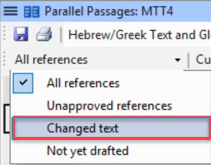
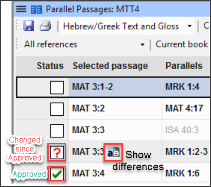
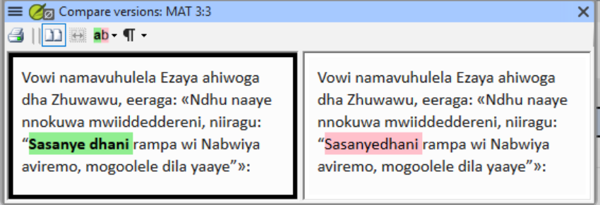

# Lesson 3: Parallel Passages

**Estimated time:** 25 minutes

**Purpose:** Support a team through the parallel passages check. You confirm that every parallel passage has really been reviewed since the last revision. You point out patterns in the tool, and you leave every decision about wording to the team.

## Learning objectives

You will be able to:

- Confirm every parallel passage has actually been reviewed since the last revision, using the Parallel Passages tool's Status column.
- Flag any verse pairings still showing a red "?" back to the team for their own decision.
- Recognize signs of over-harmonising to raise with the team.

## Connect

**✏️ Reflection:** You usually do not speak the language a team is translating into. Think about a check like "do these two parallel passages say the same thing?" What can you judge yourself? What must stay the team's decision? Keep that line in mind through this lesson.

## Content

### Your role: process, not language

You cannot judge whether two passages in the team's language say the same thing. So your job here is process:

- confirm the check was run;
- confirm the team reviewed what it found;
- hand every decision about wording back to the team.

### What the tool shows

The Parallel Passages tool opens in its own window. It shows passages that should say the same thing **side by side**. Examples are the Gospel accounts of the same event, or repeated Old Testament passages. It also shows the original-language text and gloss.

The tool shows where the passages match. It does **not** judge them. It does not flag "inconsistencies" the way a wordlist or Biblical Terms check does. The team looks at each pair and decides whether the translation is acceptable.

### Reading the shading

The tool shades matching text in every text it shows: the project's translation, the Greek and any resources.

- **Green:** the same three or more words appear in both passages. The green may look paler in the translation and resources than in the Greek.
- **No shading:** the text differs.
- **Yellow (in the Greek):** a biblical scholar marked these words by hand as equivalent. This is usually a word with a different gloss. Yellow is not an exact match, but it is still a match. Count it as shaded.

This means you can compare the shading of the Greek with the shading of the translation. You do not need to read either one. Where the Greek is unshaded, the originals differ. So the translation may differ there too.

Two patterns are worth pointing out to the team:

- **The Greek is shaded, but the translation is not.** The translation differs where the originals agree.
- **The translation is shaded, but the Greek is not.** The translation may be more harmonized than the originals.

Do not expect the shading to line up word for word. The translation's word order can differ from the Greek. What matters is that the passages are similar where the originals are similar. The words do not need to come in the same order.

*Compare the shading, not the words: Greek, translation and resource are shaded the same way.*

> **NOTE:** Either pattern is something to point out. It is not an error. Not every language can word things the same way. So some variation is acceptable, even where the originals agree. Whether the difference is right is the team's decision.

### The Status column

The tool tracks **review status** for each verse, in a **Status column**:

- A **checkmark** means the verse pairing was reviewed and approved.
- A red **question mark (?)** means the verse was edited after it was approved. It needs another look.

Use the dropdown above the table to show only the rows that need attention:

*Checkmark = reviewed and approved; red "?" = edited since approval, needs another look.*

On a flagged row, click the "Show differences" icon. It opens the two verses side by side, so you can see exactly what changed:

Show the team every verse that still has a red "?". Do not decide yourself whether the passages are consistent.

### Watch for over-harmonising

The common mistake here is **over-harmonising**. A team, or a checker who is too keen, makes parallel passages match more closely than the original texts do. Different biblical authors may tell a story differently. Parallel passages should be no more harmonized than the original texts.

That judgment belongs to the team. Where it becomes a content question about Scripture, it may belong to a Translation Consultant. Your role is to make sure each red "?" got a real decision. It must not be left unreviewed, or quietly over-corrected.

> **WARNING:** A team may say "we already checked the parallel passages." They may be remembering an earlier pass, before later revisions changed those verses. Editing a verse after approval turns its checkmark back into a red "?". So open the tool yourself and look at the Status column. This is the same "we already did that" trap from Lesson 1.

**Key takeaways**

- Your job is process and routing. Decisions about wording belong to the team.
- The tool shows matches but does not judge them. Compare the shading of the Greek with the shading of the translation. Yellow counts as shaded.
- Checkmark = reviewed and approved. Red "?" = edited since approval, needs another look.
- Parallel passages should be no more harmonized than the original texts.

## Challenge

**✏️ Try this:** Three exercises on this lesson. Try each one without looking back. Then check your answers against the Content section above.

1. **Sort the shading.** For each situation, write what it may mean. Then write whether it is one of the two patterns to point out to the team.
   - (a) The Greek is shaded green, and the translation is shaded.
   - (b) The Greek is shaded, but the translation is unshaded.
   - (c) The Greek is unshaded, but the translation is shaded.
   - (d) The Greek is shaded yellow, and the translation is shaded.
   - (e) The Greek is unshaded, and the translation is unshaded.
2. **Explain why it is not your decision.** Write the standard parallel passages are held to, in one sentence. Name the mistake that comes from missing it. Then explain why the team judges the translation against that standard, and not you. You can spot the shading patterns yourself, so say why that is not enough.
3. **Apply the Status column.** A team says they checked parallel passages two months ago. Since then they have done a revision pass. Write:
   - what you open, and what you look for;
   - what you do with each verse that shows a red "?";
   - what must be true before a difference counts as decided.

## Change

**✏️ Reflection:** Think of a team you support where you do not speak the project language. Have you ever started to judge content instead of confirming process? How could you word your feedback so the line stays clear?

**Next step:** Before your next check-review session, write one sentence you can use to hand a content decision back to the team. It should not sound like you are avoiding the work. For example: "That's a decision for your team. My job is to make sure the check ran and you've seen everything it found."

**Coming up:** [Lesson 4](04-numbers-and-measures.md) covers numbers and measures. You confirm which numbers and measures list the team's Paratext version has, and you leave the renderings to the team.
