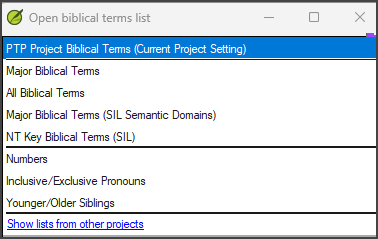

# Lesson 4: Numbers and Measures

**Estimated time:** 20 minutes

**Purpose:** Support a team through checking numbers, weights and measures. You confirm which Biblical Terms list the team's Paratext version actually has for them. The team reviews the renderings in it against their own agreed approach. You leave every decision about renderings to the team.

## Learning objectives

You will be able to:

- Confirm which numbers/measures list is actually available for the team's Paratext version — the new combined list, or only the older Numbers list with no Measures list.
- Coach the team to review the renderings in whichever list is available against their already-agreed approach.
- Route any gaps or contradictions back to the team rather than deciding the correct rendering yourself.

## Connect

**✏️ Reflection:** In Lesson 3 you left decisions about wording to the team. Numbers and measures work the same way. Think of a team you support. Do you know which Paratext version they use? Do you know where their decisions about money, weights and measures are written down? Keep those two questions in mind through this lesson.

## Content

### Your role: process, not language

You do not decide whether a number or a measure is rendered correctly. As with parallel passages, your job is process. You confirm which list is available, make sure the team reviews it, and route what they find back to the team.

### The lists are changing

Numbers and measures are not checked in Basic Checks. They are reviewed in Biblical Terms lists, and these lists are changing:

- A **new, combined list** covers numbers, weights and measures together, in one list. It is expected to become available before too long.
- It replaces the older, **separate Numbers list**.
- There is **no Measures list**. Measures was never released as its own list. Its terms are being folded into the new combined list.
- The new version does not reach every team at the same time. Some teams will stay on an older, unmigrated version for a while.

So always **confirm what the team's Paratext version actually has** before you rely on it.

### Where to look

Numbers appears as a **separate entry** in Paratext's Open Biblical Terms List dialog. Once it is available, the new combined list appears there as its own entry too. Other, unrelated lists sit alongside them, such as Major Biblical Terms, All Biblical Terms, NT Key Biblical Terms, Inclusive/Exclusive Pronouns and Younger/Older Siblings.

*You saw this dialog in Lesson 2. Check what is actually listed in this team's project.*

Do not assume a project's lists match what you have seen elsewhere.

### The two situations you may find

1. **The new combined list is available.** Confirm it is there. Then the team reviews its renderings against their documented approach to numbers, weights and measures.
2. **Only the older, separate Numbers list is available.** There is no Measures list. Numbers has fairly limited scope. Confirm the team actually reviewed it, and did not assume it was clean from an earlier pass. Numbers does not cover weights and measures. So coach the team to add the measurement terms they need to their project Biblical Terms list:
   - In **Major Biblical Terms**, open the **Biblical Terms Filter** and choose the **Realia** category. Many measurement terms are there.
   - **All Biblical Terms** has more, but no categories. The team searches for the ones they need.

   This is tedious, which is why the new list is being built. Then the team reviews those renderings against their documented approach.

> **WARNING:** Do not compare the measure renderings yourself. It is possible to do some of this by hand, but it is not easy. Ambiguous terms will slip past you. Anything inconsistent the team finds stays with them to resolve.

### Check against the team's agreed approach

Most teams decide early how to handle numbers, weights, money and measures for the whole project. For example, they decide whether to convert ancient measures to modern ones, or how to render currency. They do not decide case by case.

- The team reviews the renderings in whichever list is available against this **already-agreed, documented approach**.
- The team's review may find a gap or a contradiction. For example, a rendering does not match the approach, or two occurrences of the same measure do not match. **Refer it back to the team to resolve.** Do not decide the correct rendering yourself.
- The team may have **no documented approach** for a kind of measurement. Then that comes first. The team agrees and documents its approach before anyone resolves single inconsistencies. You cannot judge an inconsistency without a standard to check it against.

> **NOTE:** There is no confirmed field case yet of a specific numbers, weights or measures error caught by either list. So this lesson does not give one. Stay alert, and do not assume a known pattern.

**Key takeaways**

- Numbers and the new combined list are separate entries. There is no Measures list.
- Confirm what this team's Paratext version actually has before you rely on it.
- The team reviews the renderings against its documented approach. Route any gap back to the team.
- Where there is no combined list, the team adds the measurement terms to its project Biblical Terms list and reviews the renderings. You do not compare them yourself.

## Challenge

**✏️ Try this:** Three exercises on this lesson. Try each one without looking back. Then check your answers against the Content section above.

1. **Two situations that look alike.**
   - (a) The team's review finds that two occurrences of the same measurement do not match.
   - (b) There is no documented, agreed approach for that kind of measurement at all.

   Write one line for each situation, naming your next action. Then write one line on which one you must settle first when both are true, and why.
2. **Which list does this team actually have?** Open the **Open Biblical Terms List** dialog in a project you support. Note what is actually listed. Then write:
   - which of the two situations this team is in;
   - one line on what you would tell the team the list does and does not cover.
3. **One question, one sentence.** Write the question you would ask a team to find out *where* their agreed approach to numbers, weights, money and measures is written down. It could be a project note on a single term. More likely, because there are many terms, it is one reference document. Aim your question at finding whichever one exists. If your sentence hints at what the rendering should be, rewrite it.

## Change

**✏️ Reflection:** Think again about the team from the Connect section. If they are on an older Paratext version, how would you explain that their version has no list for weights and measures? How would you coach them to add the measurement terms to their project list and review them, without doing it for them?

**Next step:** Before your next support session with that team, ask the question you wrote in Challenge 3. Note which Paratext version they use and which numbers and measures list it has.

**Coming up:** [Lesson 5](05-structural-checks.md) turns to formatting checks and references. You work structural-first through chapter and verse numbers, marker pairs, headings and references. Lesson 6 then covers the Punctuation Inventory ahead of typesetting.
