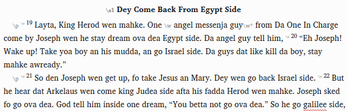
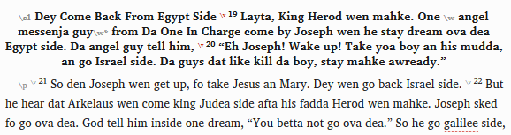
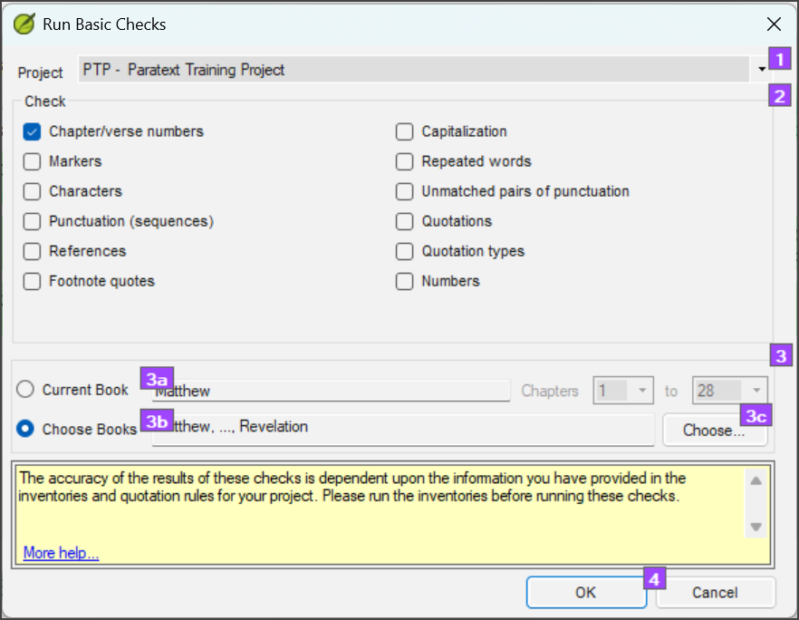
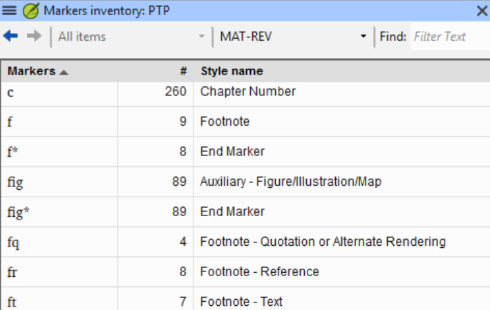
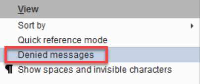
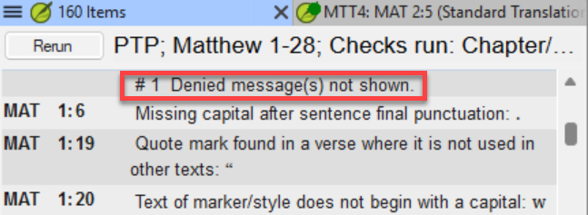

# Lesson 5: Structural Checks

**Estimated time:** 45 minutes

**Purpose:** Support a team through the structural formatting checks: chapter and verse numbers, marker pairs, headings, book titles, references and footnotes. You work in a fixed order, so that one early error does not hide behind many later ones. You coach the team to a real zero-error result, not just a fast one.

## Learning objectives

You will be able to:

- Diagnose formatting-check failures by working structural-first: chapter and verse numbering errors, unclosed marker pairs, ghost markers, wrong markers, and errors in book titles, section headings and references.
- Coach a team to a zero-error result without touching their keyboard.

## Connect

**✏️ Reflection:** Think about the last time you opened a project's Basic Checks and saw a long list of formatting errors. Where did you start? Did you fix the first error in the list? Or did you look for a pattern that might cause several errors at once? Keep that in mind. This lesson is about finding the *structural* cause before you chase single errors.

## Content

### One missing marker, many errors

Formatting errors can spread. One error in the structure can cause many others further down. Here is a common, real example.

A section heading (`\s1`) must be followed by a paragraph marker such as `\p`. If the `\p` is missing, Paratext treats everything after the heading text as part of the heading. This continues until the next paragraph-style marker (`\p`, `\m`, `\q` and so on). Verse numbers and verse text are swallowed into the heading style.

You may see:

- a heading that is much too big or looks wrong, because the verses are now part of it;
- verse numbers that seem to have disappeared from the normal text;
- references that count wrongly, because the check reads the swallowed verses as part of the heading.

In Run Basic Checks, this has a clear signature. You see **two errors for every swallowed verse**:

- "Verse number in heading"
- "Marker cannot occur here: \v"

*One missing paragraph marker, and the verse numbers disappear into the heading.*

If you start with the errors at the bottom of a long list, you may fix symptoms of one cause higher up. So work in the order below.

### The structural-first order: steps 1–4

1. **Chapter/Verse Numbers.** Run this check in Run Basic Checks first. It sits alongside Markers, Characters, Punctuation, References and Footnote quotes. Every other check reports its results by chapter and verse. If the numbering has errors (such as a duplicate verse), you cannot trust those locations.

*Confirm this one first — everything else on this list depends on it.*

2. **Marker-pair census.** Paratext has two kinds of markers:
   - **Paragraph markers** (`\p`, `\s`, `\q` and so on) stand alone and apply to a whole paragraph.
   - **Paired markers** (`\f...\f*`, `\x...\x*`, character styles and so on) wrap a piece of text. They must open and close correctly.

   Open the **Markers Inventory** (Tools > Checking Inventories > Markers Inventory). Check that every paired marker closes. One unclosed pair is often the single cause of a whole group of errors.

*This is where you check that every paired marker actually closes.*

3. **Ghost markers.** Look for markers with no content. They are often left behind when someone deletes a footnote or cross-reference but not its marker. You may see nothing wrong on screen, but they can break export and typesetting.
4. **Long/short verses.** Compare verse length with the source. A verse that is much longer or shorter can mean a misplaced verse marker, two verses merged, or missing text. Rule this out before you treat other errors in the chapter as heading or reference problems.

### The structural-first order: steps 5–8

5. **Section headings.** The marker itself is rarely wrong. Most projects use `\s1` almost always, and `\s2` only sometimes. You check structure, not wording:
   - Each heading is present, uses a heading marker, and has not swallowed verse text.
   - Compare where the headings fall with the LWC (Language of Wider Communication) Bible. The LWC Bible is your main cross-check. It shows where a heading might be missing or misplaced, without you reading the language.
   - A heading in a different place is a question for the team, not an error. Their language may divide the passage differently from the LWC.
   - Whether the wording fits the passage is the team's decision. Pass that question to them.

   > **NOTE:** A back translation helps only if someone made it by hand, outside Paratext. A back translation made in Paratext carries the translation's own headings, so comparing against it proves nothing.

6. **Book titles.** This is a consistency check. Book titles should follow a similar style across the whole Bible. In English, the problem would look like this:
   - one book is "The Gospel of Mark", another is just "Matthew", and a third is "The Gospel written by Luke";
   - books in a series don't follow one pattern. Books such as 1 and 2 Corinthians, or 1, 2 and 3 John, should be numbered and named the same way.

   You can check this without knowing the language. Most book names are names of people or places, such as Mark, Corinth or John. You can usually recognise the name in each title, then compare the words around it.
   - Show the team where the style differs.
   - Let the team choose the style.
7. **References and the table of contents.** `\r` shows parallel passages. `\xt` is the cross-reference marker. Look for:
   - book names that were missed in checking;
   - `\r` abbreviations from another language. A common cause is copying many `\r` lines from another NT project as a starting point. They bring that project's abbreviations with them;
   - a table of contents that does not match the book titles in the text.
8. **Footnotes.** A footnote can pass the marker check in step 2 and still be on the wrong verse, or appear twice. Deciding which verse a footnote belongs to needs someone who reads the text. So this review belongs to the team:
   - Ask the team to check footnote placement book by book.
   - Look for `\fq` markers in the Markers Inventory. A `\fq` marks text from the verse that is quoted inside a footnote. If the project has any, the team must run the **Footnote quotes** check in Run Basic Checks. Any edit to the verse can leave the quote out of date.

> **NOTE:** An unclosed `\f` (a footnote opened without its `\f*`) does much less harm than a missing `\p`. If it is unclosed at the end of a verse, it has no effect. If it is unclosed partway through a verse, the footnote text shows as part of the verse. That is all. It does not spread into headings, references or other markers.

Working structural-first does not mean the team must fix errors in this exact order. It means *you* look for the biggest single cause first. Then you do not send the team to correct fifty symptoms of one unclosed marker.

### Denied errors: a result can look clean when it is not

In Paratext you can **deny** a flagged error. This is meant for errors that are not really errors. In one field case, a team denied errors they did not understand. They cleared the flags instead of fixing the problems. (In the wordlist, the same shortcut is marking every word Correct — see Lesson 2.)

When a denied error is shown, it appears with **strikethrough** text. But whether it shows at all depends on **View > Denied messages**. With that option off, denied errors disappear from the list. The list shows only "Denied message(s) not shown."

*Denied errors are struck through — but only if this view option is on.*

*With the view option off, the list simply tells you denied messages exist without showing them.*

> **WARNING:** Zero formatting errors does not always mean the project is clean. It can also mean:
> - the checks were run early and not run again after later changes; or
> - errors were denied and are hidden from view.
>
> Confirm the team ran the checks again at this stage. Turn on **View > Denied messages** before you trust a zero-error result. This is the same "we already did that" trap from earlier lessons.

**Key takeaways**

- Work structural-first. Check chapter and verse numbers first, then marker pairs and ghost markers, before headings, titles and references.
- You diagnose the cause and coach the team to fix it. You never touch their keyboard.
- Trust a zero-error result only if the checks were run again at this stage and **View > Denied messages** is on.

## Challenge

**✏️ Try this:** Three exercises on this lesson. Try each one without looking back. Then check your answers against the Content section above. The aim is to find your gaps now, not in the middle of a support session.

1. **Put the steps in order.** Here are the eight structural-first steps, mixed up: footnotes · ghost markers · book titles · chapter/verse numbers · references · long/short verses · marker pairs · section headings. Write them in the right order. Then, for the first three, write one line each on why that step comes before headings, titles and references.
2. **Two unclosed markers, two very different effects.**
   - For a missing `\p` after a `\s1` heading: write what gets swallowed, and up to what point.
   - For a `\f` opened without its `\f*`: write what happens if it is unclosed at the end of a verse, and what happens if it is unclosed partway through a verse.
   - Then say which of the two spreads into other markers in the chapter, and which does not. This difference stops you treating a small error as a big one.
3. **A denied error is not a fixed one.** Write one line each:
   - how a denied error looks when it is visible;
   - which View menu setting controls whether it shows at all;
   - what the same shortcut is in the wordlist.

## Change

**✏️ Reflection:** Think of a team you support. Which errors come up most often in their Basic Checks? Every language and project has its own. Could some of them come from one cause higher up, such as a missing marker? How would you explain to the team why you check chapter and verse numbers first, even when there are only a few of those errors?

**Next step:** Before your next formatting-check session, write down the structural-first order (chapter/verse numbers → marker pairs → ghost markers → long/short verses → headings → book titles → references → footnotes). Put it somewhere you will have it in front of you.

**Coming up:** [Lesson 6](06-punctuation-before-typesetting.md) covers the Punctuation Inventory and Unmatched Pairs of Punctuation. These are the last checks to do before the project goes to a typesetter.
