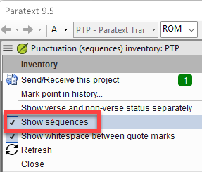
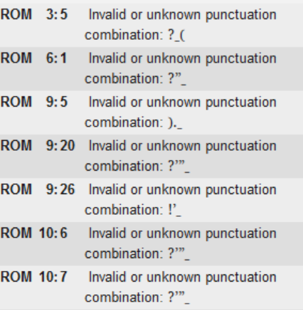

# Lesson 6: Punctuation Before Typesetting

**Estimated time:** 35 minutes

**Purpose:** Before a project goes to a typesetter, make sure the team has really reviewed Paratext's Punctuation Inventory and Unmatched Pairs of Punctuation. Problems found here are cheap to fix. The same problems found by the typesetter cost much more.

## Learning objectives

You will be able to:

- Review and use Paratext's Punctuation Inventory (Tools > Checking Inventories > Punctuation Inventory) before typesetting.
- Select "Show sequences" in its Inventory menu, so that Run Basic Checks' punctuation checkbox changes to "Punctuation (sequences)" and checks multi-character punctuation sequences, not just a plain "Punctuation" check.
- Use the Unmatched Pairs of Punctuation inventory (Tools > Checking Inventories) to find single unmatched bracket or parenthesis characters.
- Confirm that both inventories were really reviewed, not just assumed to be done.
- Recognize the settings problems that create extra work for a typesetter.

## Connect

**✏️ Reflection:** Think of a project you support that is close to typesetting. Who will see punctuation problems first: the team, you or the typesetter? If the typesetter finds them, who fixes them, and how long does it take? Keep that question in mind. This lesson is about finding those problems while they are still cheap to fix.

## Content

### Two Paratext tools for punctuation

Both tools are in Paratext, under **Tools > Checking Inventories**. Neither is part of PTXprint or anything the typesetter runs. Reviewing them is part of your own formatting check.

- **Punctuation Inventory** lists every punctuation character used in the project. With "Show sequences" selected, it also covers multi-character *sequences*. For example, several quotation marks together, or a quotation mark next to a space or a ")".
- **Unmatched Pairs of Punctuation** opens in its own window. It lists single unmatched bracket or parenthesis characters, such as "}", "[" or "(". Each row has a count and a **Status** column: a checkmark means approved, a red X means incorrect, and a blue "?" means it needs review.

The two tools work together. Each catches something the other does not, so one does not replace the other.

### Why this matters before typesetting

One consultant spent a lot of time with a typesetter after the project was handed over. Together they sorted out the Punctuation Inventory's settings. The team could have fixed these problems earlier, during their own formatting review.

### What to do

1. **Confirm someone really opened and reviewed both inventories at this stage.** When a project is nearly finished, it is easy to assume they "must be fine by now".
2. **Check the Punctuation Inventory's settings,** not just its list of characters. Unresolved characters in the settings come back later as a long list of problems for the typesetter.
3. **Select "Show sequences"** in the Punctuation Inventory tab's **Inventory** menu.
4. **Run the punctuation check** in Run Basic Checks.
5. **Review Unmatched Pairs of Punctuation directly,** using its Status column.

> **NOTE:** Whether a flagged character is valid is an orthography question. If you have the orthography statement written by the project's linguist, check the character against it. If not, the team decides.

### How "Show sequences" changes Run Basic Checks

The punctuation checkbox in Run Basic Checks just chooses which check to run. "Show sequences" changes what that check does:

- **With "Show sequences" selected,** the checkbox is labelled **"Punctuation (sequences)"**. It checks multi-character sequences.
- **Without it,** the checkbox stays labelled **"Punctuation"**. It checks only single characters.

*This checkbox is what makes "Punctuation (sequences)" mean anything.*

Each flagged result shows a combination Paratext does not recognize, with its reference. Many involve quotation marks next to other punctuation:

*This is what a flagged sequence actually looks like.*

> **NOTE:** This lesson covers punctuation sequences only. Quotation marks themselves are more complex. Paratext checks them with a separate Quotation check, covered in the Paratext Quotation Rules course, starting with Lesson 1, "What the Quotation Check Does."

"Show sequences" does not cover single unmatched brackets. That is the job of Unmatched Pairs of Punctuation:

![The Unmatched Pairs of Punctuation inventory, listing single-character pairs like "(", "\]", ")" with counts and a Status column (blue "?", green check, red X).](assets/ss-04-unmatched-pairs-punctuation.png)

*A direct list of unmatched brackets and parentheses. It shows only the characters that are actually unmatched in the project.*

> **WARNING:** "We're nearly done" does not mean "someone reviewed the punctuation." Before the project reaches a typesetter, confirm that both inventories were actually opened and reviewed at this stage.

**Key takeaways**

- Both inventories are in Paratext (Tools > Checking Inventories). Review them yourself; don't leave them to the typesetter.
- Confirm both were really reviewed at this stage, not assumed clean.
- Unresolved Punctuation Inventory settings become extra work for the typesetter later.
- Select "Show sequences" so the check becomes "Punctuation (sequences)". Without it, sequences are not checked. (Quotation marks have their own Quotation check.)
- Unmatched Pairs of Punctuation and "Show sequences" each catch different problems. Use both.

## Challenge

**✏️ Try this:** Three exercises on this lesson. Try each one without looking back. Then check your answers against the Content section above.

1. **Check one setting.** In a project you already support, open **Tools > Checking Inventories > Punctuation Inventory**. Open its **Inventory** menu and see whether **"Show sequences"** is selected. Write down what you found. Then write one sentence: how is the Run Basic Checks punctuation checkbox labelled, and what does it check, when the option is off? And when it is on? This is one setting, not a full review.
2. **A review can be real and still incomplete.** Imagine a consultant carefully reviews the Punctuation Inventory, but "Show sequences" is not selected. In two lines, say what their review missed, and what would have made it complete. Then name the difference between a false-clean result caused by a skipped step and one caused by an unselected setting.
3. **Two tools, one gap each.** In the same project, open **Tools > Checking Inventories > Unmatched Pairs of Punctuation**. Write one line on what it lists that "Show sequences" does not. Write one line on what "Show sequences" catches that Unmatched Pairs of Punctuation does not.

## Change

**✏️ Reflection:** Think again of your project that is close to typesetting. Has anyone, team or you, opened the Punctuation Inventory and Unmatched Pairs of Punctuation recently? Or is everyone assuming they are clean? What would it cost to check now, compared with hearing about it later from a frustrated typesetter?

**Next step:** Add this standing question for every project close to typesetting: "Punctuation Inventory and Unmatched Pairs of Punctuation — both really reviewed?"

**Coming up:** Lessons 7 and 8 turn to glossary linking and the final layout and draft-PDF read-through. As with the Punctuation Inventory here, you will do hands-on technical setup alongside your coaching role.
