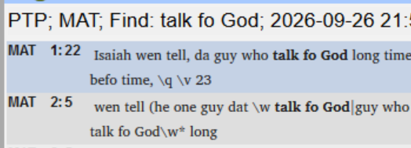
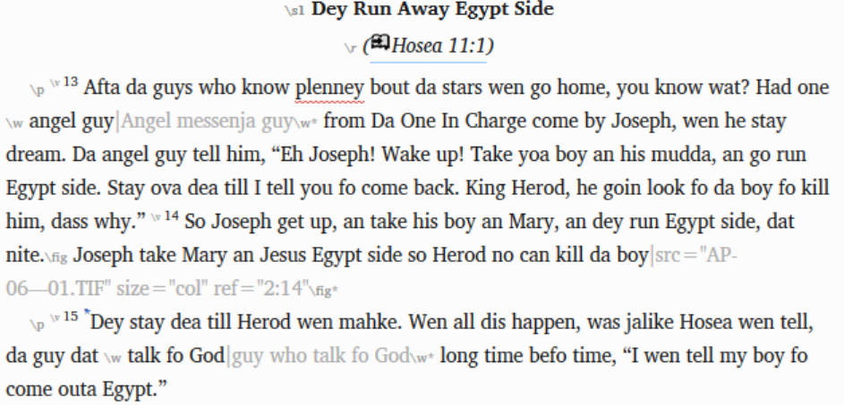

# Lesson 7: Glossary Linking

**Estimated time:** 30 minutes

**Purpose:** Support a team through the glossary-linking operation. You check that each glossary term is linked at the right scope: the first time it appears in each section, not every time. If the scope is wrong, you coach the team to fix it.

## Learning objectives

You will be able to:

- Diagnose over-linked glossary marking (every occurrence instead of first-per-section).
- Coach a team to unlink and relink at the correct scope.

## Connect

**✏️ Reflection:** Think of a printed book with a glossary at the back. A small mark in the text tells you that a word is in the glossary. How useful is that mark the first time you meet a hard word? How useful is it the tenth time, on the same page? This lesson is about putting a glossary link where the reader needs it, and nowhere else.

## Content

> **NOTE:** This course covers the glossary-linking **operation and its checks** — the marks in the text. Glossary *content* (what goes in the glossary, and writing the entries) is out of scope; a separate course will cover it. This lesson assumes the team already has a glossary.

### Over-linking: the common mistake

A glossary link belongs at the **first occurrence** of a term **in each section**. That is the first place a reader is likely to need the definition.

The common field mistake is **over-linking**: the team links **every occurrence** of the term. The reader sees the same glossary mark again and again, and the link loses its purpose. In one field case, the consultant unlinked the terms. Then the consultant relinked them at **"first occurrence in every section,"** not "all occurrences."

### Check with Find, not the link report

The glossary-link operation gives no pass/fail result. Its report of linked occurrences is **transient**. It is replaced as soon as you link the next item or group. Teams often link in batches, because the operation is complicated, so earlier reports are gone. The row count does not help either: some terms are simply more frequent than others.

So use Paratext's **Find**. You can run it again at any time. Search the project for the glossary term (for example, "angel").

Glossary links are marked with `\w` and `\w*` around the linked words, in the form `\w <surface text>|<rendering>\w*`. For example:

- `\w angel messenja guy\w*`
- `\w angel guy|Angel messenja guy\w*` — used when the words in the text differ from the glossary entry's own rendering.

*This is the markup a correctly-scoped link leaves behind.*

You can also see this markup in the text editor. The rendering half of a `\w...\w*` marker shows in **light grey** in the running text, so you can scan a passage by eye.

*The grey text is the marker's rendering half — visible right in the text, not just in Find results.*

Look at each Find result:

- Markup around **every occurrence** of the term means over-linking.
- Markup around only the **first occurrence in each section** means the scope is correct.

To fix over-linking, **unlink** the extra links. Then **relink** at **"first occurrence in every section."** You can do this in the tool yourself, because links are markup, not translated text. You still never change the team's translation itself.

> **WARNING:** Do not trust the number of Find results. Find also matches the same words inside the rendering half of an existing `\w...\w*` marker. Open each result. Check whether it has its own markup, or sits inside another marker's rendering.

### A term inside a longer term

Glossary terms can overlap. For example, "Holy Spirit" is a phrase term, and "Spirit" is also a term on its own. If you search for "Spirit", a result may sit inside a marker whose rendering is "Holy Spirit". That is correct. The word is linked to the phrase term, and it should **not** also be linked as "Spirit".

This is why phrase terms are linked **before** the single words inside them. So when a result sits inside a marker, read the rendering before you flag it.

> **TIP:** To check every linked term at once, type `regex:` in Find (no space after the colon), then search for `\w[^\]*\w\*`. This returns every `\w...\w*` occurrence in one search. (A test search found 22 in Matthew alone.)

### Watch for a false-clean result here too

The Project Plan task "Check and link glossary entries" (Stage 6, Final Preparation for Publication) has its own checkbox. A person ticks it; Paratext does not set it from the linking data. As with any Project Plan status (Lesson 1), treat it as a starting point, not proof. A Find search of the markup shows whether the scope is right.

**Key takeaways**

- Link at the first occurrence in every section. To fix over-linking, unlink, then relink at that scope. You can do this yourself.
- The link report disappears, so check with Find. Read the markup on each result; do not trust the count.
- A result inside a longer phrase term's marker is correct.
- A ticked Project Plan checkbox does not prove the linking was reviewed.

## Challenge

**✏️ Try this:** Three exercises on this lesson. Try each one without looking back. Then check your answers against the Content section above.

1. **Choose your check.** Write one line on why the linked-occurrences report is not a reliable check once linking is done. Then name the tool you would use instead.
2. **Sort the Find results.** You search a project for "Spirit". For each result below, write *over-linked*, *correct*, or *count proves nothing*:
   - a. In one section, only the first occurrence is wrapped in a `\w...\w*` marker. The other occurrences in that section are plain text.
   - b. In one section, every occurrence is wrapped in its own `\w...\w*` marker.
   - c. The word sits inside a marker whose rendering is "Holy Spirit".
   - d. Find shows 40 results for the term in one book.
3. **Name the fix.** Write the two steps that fix over-linking. Use the tool's own wording for the correct scope. Then say in one line why that scope helps the reader.

## Change

**✏️ Reflection:** Think of a team you support that will soon link its glossary. Will they link in batches? How will you check their work after the link report is gone? What would you say if the team shows you a ticked Project Plan checkbox?

**Next step:** Before your next glossary-linking session, try the `regex:` search from this lesson in a project you can open. Then you will know what the results look like before you sit down with a team.

**Coming up:** [Lesson 8](08-layout-and-read-through.md) covers layout and hyphenation decisions for print, and the final PTXprint draft-PDF read-through.
