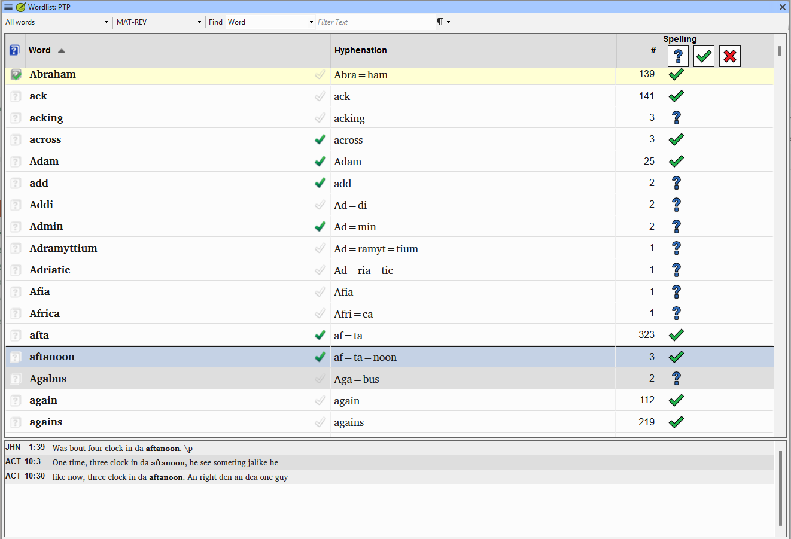
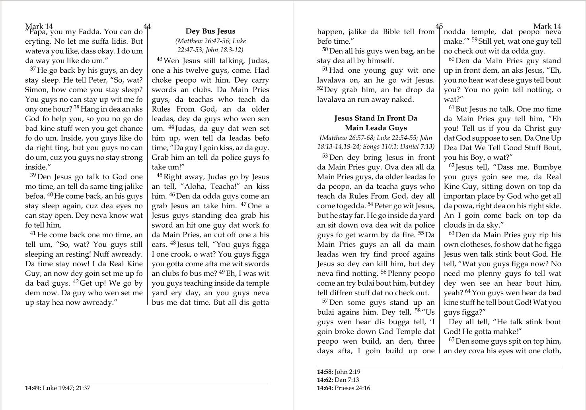
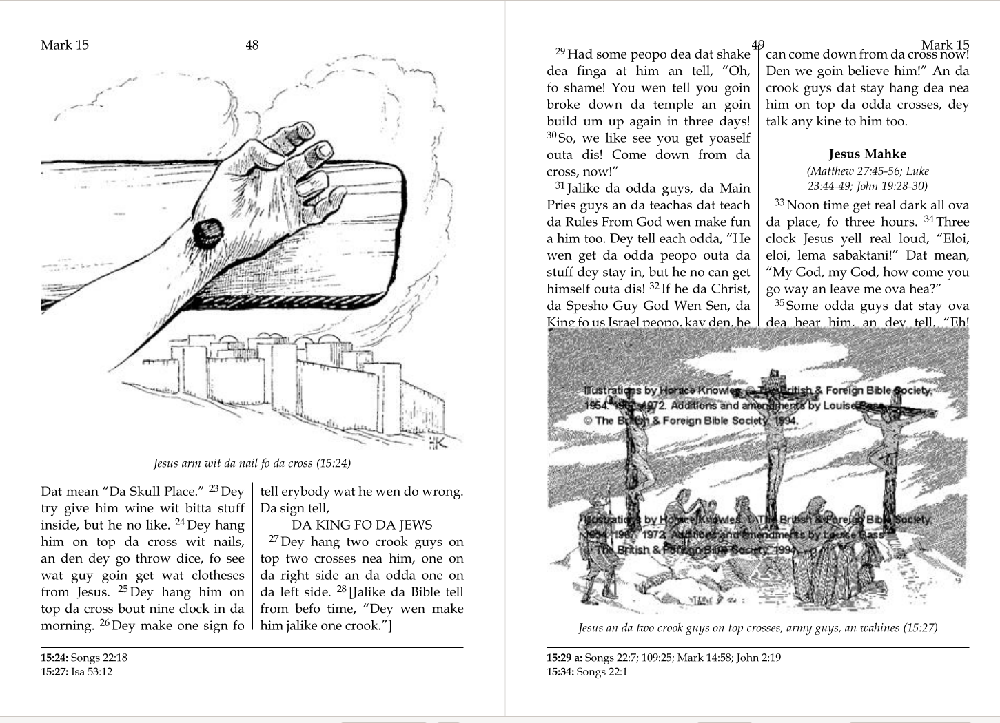
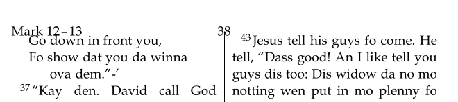

# Lesson 8: Layout and the Draft-PDF Read-Through

**Estimated time:** 35 minutes

**Purpose:** Support a team through layout and hyphenation decisions for print. Then lead the final PTXprint draft-PDF read-through. These are the last checks before the team's files go to the typesetter.

## Learning objectives

You will be able to:

- Advise a team on a single- versus two-column layout, based on what readers and the community expect, not just word length.
- Use the Wordlist's Show hyphenation view to draft, enter and approve hyphenation breaks, one at a time and in batches.
- Make sure the team confirms each break, so long words break correctly in a two-column layout.

You will be able to:

- Lead a team through the final PTXprint draft-PDF read-through.
- Resolve or triage what it finds, and leave true typesetting composition to the typesetter.

## Connect

**✏️ Reflection:** Picture the very last read-through before a team's files go to the typesetter. Small things are easy to miss here: a word alone at the top of a column, a footnote that moved to another page, a heading in an awkward place. This is the last chance to catch them. How sharp is your attention at the end of a long review? This lesson helps you build habits that work on any day.

## Content

### Layout: start with what readers expect

In one field case, an expat project admin chose a **single-column** layout. The language has long words, and the team had never used hyphenation.

But the community does not yet have a Bible in its own language. It reads Bibles in a **Language of Wider Communication (LWC)**, a regional trade language. Those LWC Bibles are printed in **two columns**, so readers expect two columns. That expectation is the baseline, even if the LWC does not have the long-word problem. The layout had to be two-column. Long words only told the team that it needed hyphenation.

Your role has two parts:

1. **Advise.** Ask what layout the community's LWC Bibles and other printed materials use. Do not choose a layout just because it avoids a technical problem.
2. **Do the technical setup.** Once two columns is the right choice, set up hyphenation in the Wordlist.

### Show hyphenation in the Wordlist

1. Add the hyphen to the **word-medial punctuation** list: Project > Project settings > Language settings > Other Characters tab. Most Roman-script languages use the hyphen to break words. Other scripts may use a different character.
2. Open **Tools > Wordlist**.
3. From the Wordlist's own tab menu, choose **View > Show hyphenation**. It sits next to "Show morphology" and "Show spelling status".
   - A hyphenation column appears. It shows Paratext's guessed break points for each word.
   - Equal signs mark the breaks, for example `an=ti=no=mi=an=ism`. Each `=` is a place where the word may break across a column.

Each word also has a tick:

- A **grey tick** means Paratext *guessed* the breaks. No one has reviewed them yet.
- A **green tick** means the breaks are **approved**.

*Grey = Paratext's guess; green = a human confirmed it.*

### The team decides each break

Where a word may break is a fact about the language. You do not speak the language. So neither Paratext's guess nor your own impression settles it. **The team decides each break.** You do the drafting and the tool work.

1. **Ask the team for their orthography statement.**
   - If they have one, draft breaks from the syllable structure it describes. Add or remove `=` marks on Paratext's guesses where its syllable rules point.
   - An orthography statement is not always final. Translation can start with a trial orthography, and the community may not accept every choice in it. Ask whether the statement is still current, and whether the community has accepted it.
   - If the team cannot find it, it does not describe syllable structure, or it is still a trial orthography, do not guess. The team proposes the breaks, and you enter them in the Wordlist.
2. **Have the team review and confirm each break.** Go through the drafted and guessed breaks with a team member who speaks the language and also writes it well. Not every speaker reads well or spells consistently, and the New Testament may be the largest book ever printed in the language. They say whether each break is right. Where the team is unsure, they check with community members who read and write the language well. Readers notice a word broken in the wrong place.
   - If they say a break is wrong, click the word. Add or remove `=` marks where they say the breaks fall. The tick turns green automatically when you edit the word.
3. **Approve one confirmed word:** click its grey tick.
   - The tick turns green. The word is approved.
4. **Approve a group of confirmed words:** select the first word. Shift-click to select a run of words, or Ctrl-click to pick separate words. Then use the Wordlist's tab menu > **Edit > Approve word hyphenation**.
   - Every selected word is approved at once.
5. **Before the files go to print,** check that no grey ticks remain on words the team has not reviewed.

> **WARNING:** When you edit a word, its tick turns green before the team has seen it. So the breaks you drafted look approved already. Keep a note of the words you drafted. Then the team's review covers those words as well as the grey ticks.

> **TIP:** As more words are approved, Paratext's guesses get better. Late in the review, the team may confirm a run of words at a glance, and batch approval saves the most time. The team still confirms each break; batch approval only records it faster.

The approvals save to **`hyphenatedWords.txt`** in the project folder when you close the Wordlist. A line with a leading `*` is team-approved. A line without `*` is still an unapproved Paratext guess.

> **WARNING:** PTXprint's draft-PDF export uses unapproved guesses as well as approved hyphenation, so a draft can look fine with guesses unreviewed. Approve hyphenation before the files go to print.

> **NOTE:** Two things to watch for:
> - In a Study Bible Publication project, the Wordlist is view-only. You cannot approve hyphenation there.
> - **Word break characters** are not only for non-Roman scripts. The hyphen you added to the word-medial punctuation list is one. Hyphenation adds hyphens as word break characters, but only uses them when a word falls near a line end.

> **TIP:** For unusual cases, `hyphenatedWords.txt` can be edited by hand to customize hard/soft hyphens and hyphenated markers (`HardHyphen`, `SoftHyphen`, `SoftHyphenOut`, `HyphenatedMarkers`). Most teams do not need this.

### The final PTXprint draft-PDF read-through

This is the team's last look before the typesetter. Work through the full draft PDF in PTXprint, and watch for five things:

- **Spreads** — how facing pages look together, not just one by one. Check that each pair looks balanced.
- **Orphan words** — a single word left alone at the top or bottom of a column or page.
- **Footnote shifts** — a footnote that has moved to a different page from its reference.
- **Heading placement** — a heading in an awkward place at a page or column break.
- **Underfilled pages** — a page with much more white space than the pages next to it.

*A heading held together with its paragraph pushed the whole block to the next column — leaving this underfilled gap behind it.*

The read-through also finds composition issues outside this list. Examples are picture size and spacing, and page-margin spacing.

*An oversized picture, and one crowded too close to its own credit text — both are typesetting-craft issues to flag, not fix yourself.*

*Not enough top-margin space between the running header and the body text below it.*

> **NOTE:** This course's team workbook material was checked against **PTXprint 3.0.38**. PTXprint updates often, so menu labels may have moved. Check against the version in front of you. Underfilled-page auto-fill is available from **PTXprint v3.0.19+**. On an older installation, check that the feature exists before you rely on it.

### Resolve what you can, triage the rest

For each issue the read-through finds, decide whose it is:

- **Yours to fix** — for example, a linking or markup scope issue.
- **The team's call** — anything about the content.
- **The typesetter's** — true typesetting composition. This is the typesetter's craft. Do not try to solve it yourself.

**Key takeaways**

- Layout follows what readers expect, such as two-column LWC Bibles, not word length alone.
- In the Wordlist, you draft or enter the breaks and approve them (grey tick to green), one at a time or in batches. The team decides whether each break is right.
- Approve all hyphenation before print. PTXprint's draft PDF uses unapproved guesses too.
- In the read-through, watch for spreads, orphan words, footnote shifts, heading placement and underfilled pages. Then triage each issue: yours, the team's, or the typesetter's.

## Challenge

**✏️ Try this:** Five short exercises on this lesson. Try each one without looking back. Then check your answers against the Content section above.

1. **Two criteria, one decision.**
   - Write one line on what long words can tell you about a layout choice.
   - Write one line on what sets the baseline for the layout.
   - Write one question you would ask the team about what the community already reads.
2. **Put the hyphenation steps in order.** The team has an orthography statement. Here are the steps, mixed up: the team reviews and confirms each break · choose View > Show hyphenation · check that no unreviewed grey ticks remain · add the hyphen to word-medial punctuation in Language settings · open Tools > Wordlist · draft breaks from the orthography statement · approve confirmed words with Edit > Approve word hyphenation. Write them in order. Then answer in one line each:
   - What changes if the orthography statement cannot be found, or does not describe syllable structure?
   - A word you drafted already has a green tick. Why does it still need the team's review?
3. **Which read-through check is it?** The read-through has five things to watch for: spreads, orphan words, footnote shifts, heading placement and underfilled pages. Each line below describes a problem on a draft page. Name which of the five it is:
   - a. One word sits alone at the top of the second column.
   - b. The footnote for a verse is printed on the next page, not on the verse's page.
   - c. One page has much more white space at the bottom than the pages around it.
   - d. A section heading sits at the very bottom of a column. Its paragraph starts in the next column.
   - e. Each page looks fine alone. But side by side, the text on the left page ends several lines higher than the text on the right page, so the pair looks unbalanced.
4. **Yours, the team's, or the typesetter's?** Write who should deal with each issue:
   - a. A glossary term is linked at every occurrence in a section.
   - b. A team member asks whether a heading's wording fits its passage.
   - c. A picture is too big for the page.

   Then write, in one line, the general test you used.
5. **Check your own PTXprint.** Find which PTXprint version is installed on the machine you would use with a team. Is it new enough for underfilled-page auto-fill? If it is not, update to the latest version.

## Change

**✏️ Reflection:** Think of a team you support. What layout do the LWC Bibles in their community use? Has anyone asked the team? Which of the five read-through checks are you most likely to miss when you are tired?

**Next step:** Before your next final read-through with a team, write down the five things to watch for: spreads, orphan words, footnote shifts, heading placement and underfilled pages. Put the list where you will have it open during the review.

**Coming up:** With the check areas covered, the scenario bank puts everything from this course together in mentor-reviewed, applied scenarios. These include the false-clean thread that runs through two of the core cases.
